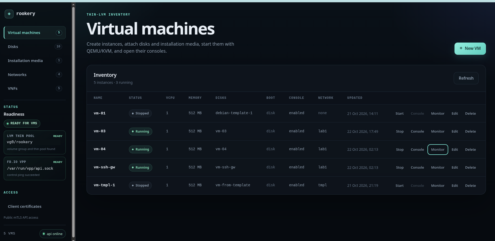
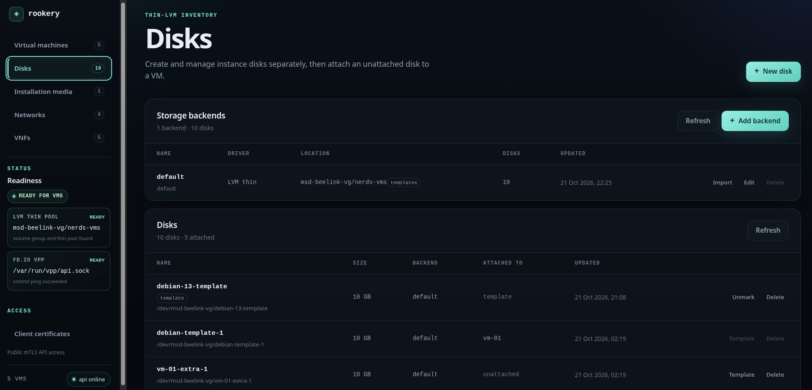
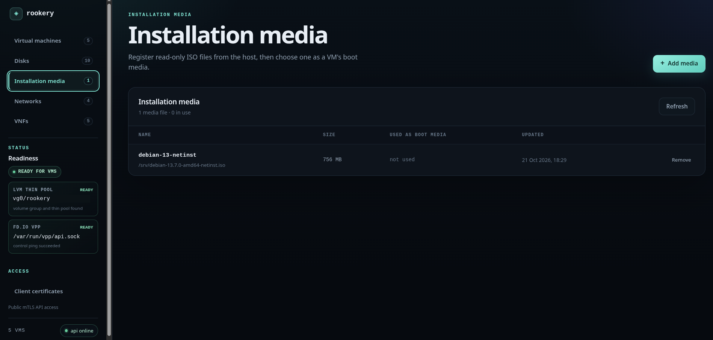
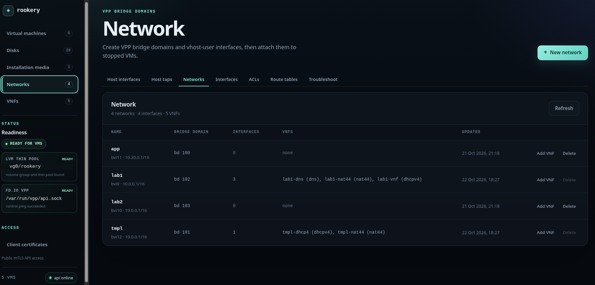
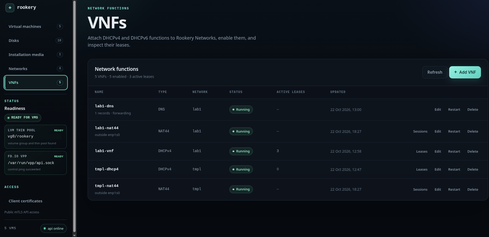
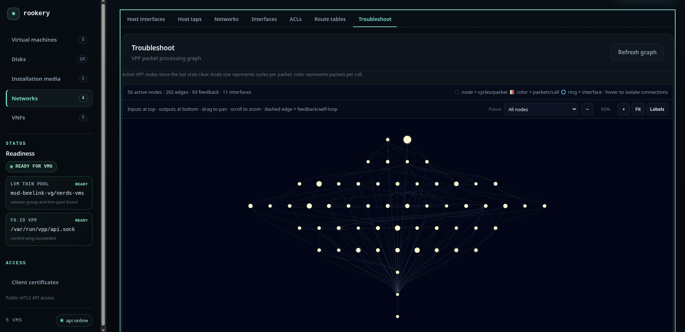
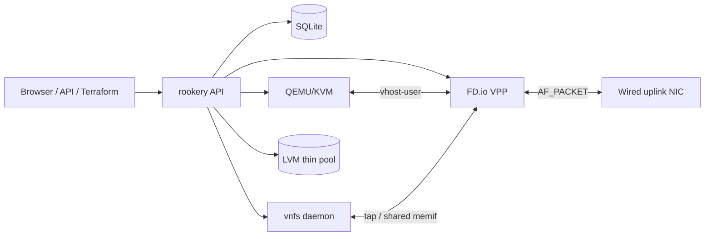

# Rookery

Rookery is a self-hosted VM and network manager for Linux. It combines
thin-provisioned LVM disks, QEMU/KVM, FD.io VPP networking, and optional
DHCP/DNS/BGP network functions behind one API and embedded web UI.

It is designed for a single host: create disk images once, attach them to VMs,
and connect VMs through isolated VPP bridge domains with optional NAT44 access.

```c
void *it = hardware;
rookery(it);  // VOID STAR IT
```

## Why Rookery?

If you’re a solo developer or a small startup, you probably have a physical
server with spare capacity. It might already run GitHub Actions runners, tests,
or short-lived environments, and it could host a few VMs too.

Setting up a full virtualization platform for that is often more work than the
VMs themselves. Rookery is meant to make it practical: a small, self-contained
manager for VMs, thin-LVM storage, and VPP networking that sits next to
everything else on the host without bringing in a heavyweight stack.

I built it because I wanted that tool for my own server. I hope it’s useful to
you too.

[](docs/imgs/vms.png)

*The VM inventory shows live QEMU status, attached disks, boot media, console
access, and per-VM monitoring.*

## Capabilities

- Thin-LVM disks, template clones, and existing-volume import
- QEMU/KVM virtual machines with virtio disks, ISO boot media, and noVNC console
- LightVMs that boot an uploaded kernel/initramfs and a buildah-mounted container rootfs through virtiofsd, with an xterm.js serial console
- cgroup v2 CPU pinning, memory ceilings, and per-device I/O limits with reusable class profiles
- Live cgroup telemetry for memory, CPU, tasks, and I/O in Settings
- Free-form labels on inventory entities, with label chips and multi-label editing in the UI and Terraform
- VPP bridge domains, vhost-user interfaces, ACLs, VRFs, and static routes
- Optional NAT44 with DHCP outside addressing and DNAT rules
- DHCPv4, DHCPv6, DNS, and BGP VNFs in a separate `vnfs` daemon
- Embedded Preact/TypeScript inventory UI
- REST and gRPC APIs, public mTLS listeners, and a Terraform provider
- Single static binary per process for Linux x86_64/amd64

## Screenshots

### Storage

| Thin-LVM disks | Installation media |
| :---: | :---: |
| [](docs/imgs/disks.png) | [](docs/imgs/installation-media.png) |
| **Thin-LVM disks** — backends, templates, clones, and attachment state. | **Installation media** — register host ISOs as read-only boot media. |

### Networking and VNFs

| Rookery Networks | Network functions |
| :---: | :---: |
| [](docs/imgs/networks.png) | [](docs/imgs/vnfs.png) |
| **Networks** — VPP bridge domains, interfaces, ACLs, VRFs, and route tables. | **VNFs** — DHCPv4/DHCPv6, NAT44, DNS, and BGP with leases and sessions. |

### VPP troubleshooting

[](docs/imgs/network-troubleshoot.png)

*Inspect the live VPP packet-processing graph, focus on an interface or feature,
and drill into trace, ACL counters, and packet captures.*

## Architecture at a glance



The API owns SQLite, LVM, QEMU, and VPP network provisioning. The `vnfs` daemon
owns DHCP, DNS, BGP, and gVisor memif runtimes so API restarts do not interrupt
them.

For C4 diagrams, component responsibilities, data flows, and the storage model,
see [docs/architecture.md](docs/architecture.md).

## Requirements

Host:

- Linux x86_64/amd64
- LVM2 tools and an existing volume group
- QEMU/KVM (`qemu-system-x86_64`, `/dev/kvm`)
- `buildah` and `virtiofsd` for LightVMs; `virtiofsd` defaults to the
  directory containing the `rookery` binary, and QEMU must include
  `vhost-user-fs-pci`. If either tool is missing, the LightVM tab shows a
  runtime-unavailable banner and disables Start. Run `make virtiofsd` to
  download the static x86_64 binary into `extra/virtiofsd/`; release archives
  include it next to `rookery`.
- FD.io VPP with its binary API enabled, normally `/run/vpp/api.sock`
- VPP `vhost` and `acl` plugins
- `vppctl`, `ip`, and `ethtool` available to the service user
- Root, or the equivalent `CAP_NET_ADMIN`, `CAP_NET_BIND_SERVICE`, and
  `CAP_NET_RAW` capabilities for VNF taps and host-NIC takeover
- A **wired** NIC for NAT44 outside use; wireless and the default-route NIC
  are rejected

Build only:

- Go 1.26 or newer
- Node.js 24 and npm for rebuilding the web UI

No external DHCP or DNS server is required. The release archive contains
static `rookery`, `vnfs`, and `terraform-provider-rookery_<version>_linux_amd64`
binaries and does not require Go or Node.

The API intentionally has **no authentication** on its local HTTP listener,
including the VNC proxy. Keep it on localhost or behind an access-controlled
proxy. Use the public mTLS listener for remote API clients.

## Quick start

### 1. Install

Download the latest `linux-amd64` archive from the
[releases page](https://github.com/voidstarit/rookery/releases) and unpack it:

```sh
tar -xzf rookery-*-linux-amd64.tar.gz
sudo install -d /etc/rookery
sudo install -m 0755 rookery-*/rookery rookery-*/vnfs /usr/local/bin/
sudo install -m 0644 rookery-*/config.example.yaml /etc/rookery/config.yaml
```

Or build from source:

```sh
make build
sudo install -d /etc/rookery
sudo install -m 0755 bin/rookery bin/vnfs /usr/local/bin/
sudo install -m 0644 config.example.yaml /etc/rookery/config.yaml
```

### 2. Configure

Edit `/etc/rookery/config.yaml`. A minimal setup is:

```yaml
api:
  vg: vg0
  thin_pool: rookery
  vpp_socket: /run/vpp/api.sock

vnf:
  listen: unix:///run/rookery/vnfs.sock
```

Both binaries read the same file. `-config` and `ROOKERY_CONFIG` select it;
command-line flags override environment variables, which override the file.
See [configuration](docs/operations.md#yaml-configuration) for every field.

### 3. Initialize the thin pool and VPP

```sh
sudo rookery init -config /etc/rookery/config.yaml
```

`init` is idempotent. It creates the thin pool only when missing and verifies
the VPP binary API.

### 4. Run the VNF daemon and API

```sh
sudo vnfs -config /etc/rookery/config.yaml
sudo rookery serve -config /etc/rookery/config.yaml
```

Use separate terminals or service units. The API starts without the daemon and
shows VNFs as `degraded` until it can connect. The local UI is served at
<http://127.0.0.1:8080>.

### 5. Use the UI or API

Create storage backends, disks, media, VMs, networks, interfaces, ACLs, route
tables, and VNFs from the UI. The API also exposes generated REST and gRPC
services; public remote access is available through the mTLS listeners.

The release also publishes `terraform-provider-rookery_<version>_linux_amd64`
standalone and inside the archive. For Terraform, put that binary in a
directory, download a client certificate from **Client certificates** in the
UI, and configure the provider as shown in
[docs/api.md#terraform-provider](docs/api.md#terraform-provider). To issue a
certificate from the host instead, run
`rookery create-client-cert -config /etc/rookery/config.yaml -out-dir ./ops-laptop ops-laptop`.

## Documentation

| Document | Contents |
| --- | --- |
| [Architecture](docs/architecture.md) | C4 context/container/component diagrams, data flows, storage model, reconciliation |
| [Operations](docs/operations.md) | Prerequisites, install, initialize, run, logging, configuration, flags, VM lifecycle |
| [Networking](docs/networking.md) | VPP networks, interfaces, ACLs, route tables, host taps, VNFs, NAT44 |
| [API and access](docs/api.md) | mTLS, Terraform, protobuf design, HTTP endpoint reference |
| [Development](docs/development.md) | Build, test, UI, protobuf generation, releases |
| [API design](docs/api-design.md) | Deep protobuf generation and validation notes |

## Development

```sh
make build       # UI + rookery, vnfs, Terraform provider
make test        # UI build + go test ./...
make vet
make ui-typecheck
make release VERSION=v0.1.0
```

`make build` requires Node/npm only for the UI bundle. Plain `go build` and
`go test` use the committed bundle. Release tags trigger the workflow in
`.github/workflows/release.yml`, which publishes the `linux-amd64` archive and
checksum.

See [docs/development.md](docs/development.md) for UI routing/events, tests,
protobuf generation, and release details.

## License

Rookery is licensed under the [Apache License 2.0](LICENSE).

Third-party components are listed in [THIRD_PARTY_NOTICES.md](THIRD_PARTY_NOTICES.md).
Contributions are covered by [CONTRIBUTING.md](CONTRIBUTING.md). Please report
security issues through the private process in [SECURITY.md](SECURITY.md).

## Security

- The local HTTP listener is unauthenticated; bind it to localhost or protect
  it with an authenticating proxy.
- The public mTLS HTTP/gRPC listeners require a client certificate signed by
  the Rookery CA. Native VNC, pcap, PKI, and static routes are only on the local
  listener.
- Per-VM `console_enabled` controls the VNC WebSocket, but it is not a
  substitute for API authentication.
- Back up the PKI directory. Losing the CA invalidates every issued client
  certificate.
