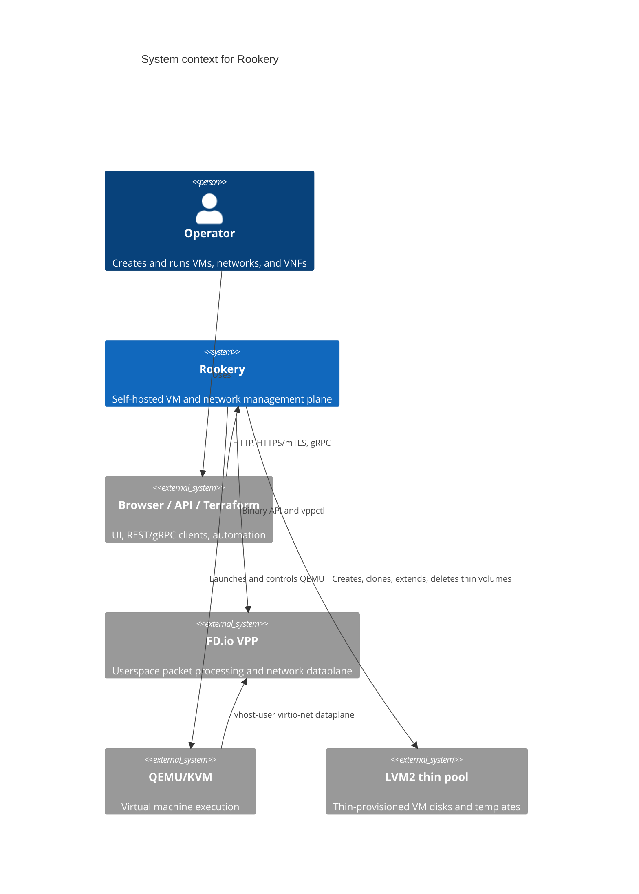
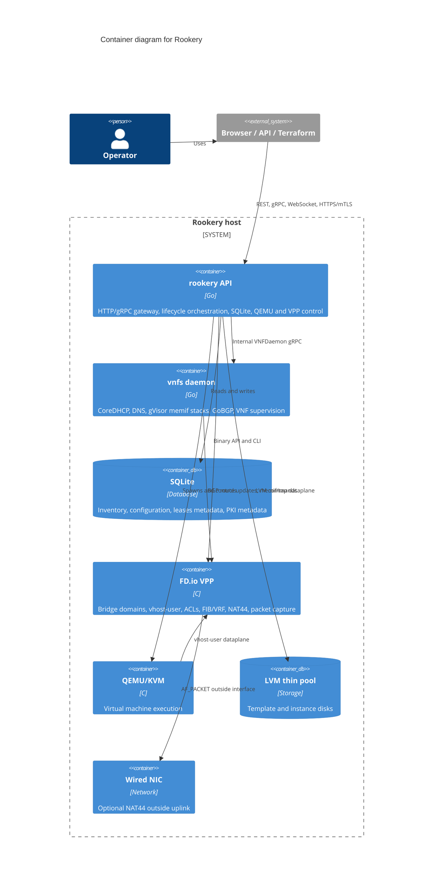
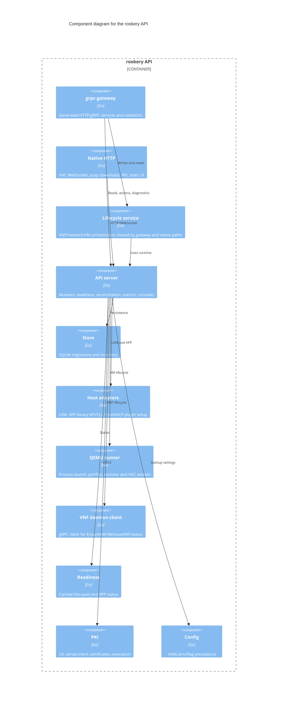
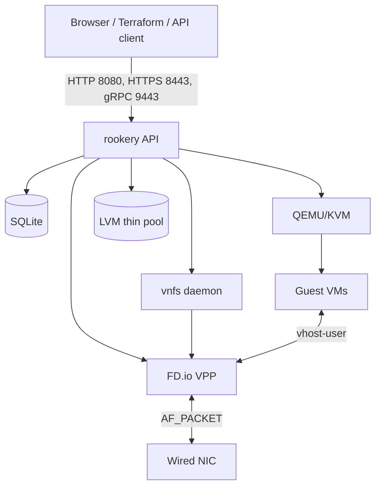
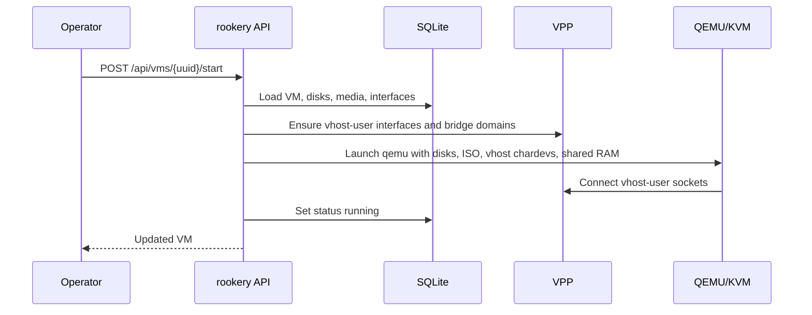
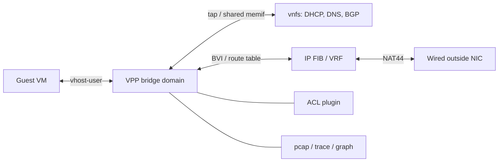

# Architecture

Rookery is a single-host management plane for KVM virtual machines backed by
LVM thin storage and FD.io VPP networking. It is split into two long-running Go
processes:

- `rookery` owns the API, SQLite, QEMU lifecycle, LVM, and VPP network
  provisioning.
- `vnfs` owns the long-running DHCP, DNS, and BGP userspace runtimes, so API
  restarts do not interrupt them.

The web UI, REST/gRPC gateway, QEMU arguments, VPP provisioning, and VNF
control paths are all implemented in this repository.

## C4 system context



## C4 container diagram



## C4 component diagram: API process



## Deployment view



The local UI listener is unauthenticated and defaults to `127.0.0.1:8080`.
The public mTLS HTTP and gRPC listeners are separate; only gateway API calls are
exposed there.

## Main request and lifecycle flows

### VM start



QEMU always runs with `-nic none`; guest networking is explicitly built from
attached VPP vhost-user interfaces. `reconnect=1` lets QEMU reattach after VPP
recreates its sockets. `POST /api/vms` performs the same launch steps right
after inserting the VM record, so new VMs are running; if the launch fails the
record is removed again and the error is returned. Each VM stores the power
state it should have (`desired_state`): starting or creating a VM records
`running` and stopping records `stopped`. After the VPP resources are
reconciled, the API starts every VM that should be running but has no live QEMU
process, which brings VMs back after a host reboot while leaving explicitly
stopped VMs down.

When cgroup limits are enabled, before QEMU is launched, the cgroup manager
creates or reuses a child cgroup (`shared` or `vm-<uuid>`) below the configured
parent and applies host and VM limits. QEMU is started with
`CLONE_INTO_CGROUP` where available, then its pid is written to `cgroup.procs`
as a fallback, so every QEMU process is accounted under the hierarchy.

### Network dataplane



Each Rookery Network gets a VPP bridge domain and a VRF (`100000 + network ID`).
The BVI owns the gateway address, the shared VNF memif owns the service address,
and overlapping CIDRs are isolated by the per-network VRF.

### VNF lifecycle

```mermaid
sequenceDiagram
  participant A as rookery API
  participant V as VPP
  participant D as vnfs daemon

  A->>V: Create tap/memif and attach to network BD
  A->>V: Bind interface to network VRF
  A->>D: EnsureVNF(desired spec)
  D->>V: Open VPP binary API for BGP routes
  D-->>A: runtime state
  Note over A,D: API keeps DB and VPP ownership; daemon keeps runtime state
```

The daemon persists desired specs under the run directory, restores them on its
own restart, and supervises dead runtimes. The API reconciles daemon state after
API/VPP restarts and can run without the daemon; enabled VNFs report `degraded`.

## Storage and data model

SQLite is the inventory source of truth. The embedded migrations under
`internal/store/migrations` define the schema; key tables are:

| Area | Tables |
| --- | --- |
| Storage | `storage_backends`, `disks`, `vm_disks` |
| VMs | `vms`, legacy `vms.disk_id` compatibility column |
| Media | `media` |
| Networks | `networks`, `virtual_interfaces`, `network_host_taps` |
| Network policy | `acls`, `interface_acls`, `route_tables`, `routes` |
| VNFs | `vnfs` |
| Host takeover | `host_interfaces` |
| PKI | `client_certificates` |

Disks and VMs are separate resources: a disk must exist before a VM can attach
it, and a disk can belong to only one VM at a time. Storage backends are
extensible records; only `lvm-thin` is implemented today. Templates and
script-created clones are tracked on `disks`.

The SQLite driver is pure Go (`modernc.org/sqlite`), so binaries do not require
CGO or a system SQLite library.

## Code and documentation structure

```text
cmd/rookery/                    API, init, serve
cmd/vnfs/                       DHCP/DNS/BGP daemon
cmd/terraform-provider-rookery/ Terraform provider over mTLS gRPC

internal/api/                   HTTP/native handlers, VPP/NAT/DHCP orchestration
internal/lifecycle/             shared write orchestration for gateway/native paths
internal/gateway/               generated service implementations
internal/store/                 SQLite, migrations, inventory types
internal/host/                  LVM, VPP, DHCP/DNS/BGP runtimes, vhost/memif/tap
internal/qemu/                  QEMU process, monitor, VNC, metrics
internal/cgroup/                cgroup v2 hierarchy, limits, CPU/device helpers
internal/vnfd/                  internal VNFDaemon gRPC protocol
internal/readiness/             cached host prerequisite status
internal/pki/                   mTLS CA and client certificates
internal/config/                YAML configuration loader
internal/webui/                 embedded UI and vendored static assets
ui/                             Preact/TypeScript sources
design/                         protobuf source, generated code, OpenAPI
docs/                           this documentation set
```

## Reconciliation and failure model

On startup the API waits for VPP, then reconciles:

1. bridge domains
2. network host taps
3. vhost-user interfaces
4. route tables and routes
5. ACL definitions and assignments
6. persisted host NIC takeovers
7. enabled NAT44 VNFs
8. enabled DHCP/DNS/BGP VNFs
9. network/VNF interface VRFs

VPP state is in memory. API startup recreates missing objects and refreshes
stored indices. While the API runs, it control-pings VPP every five seconds and
compares the API socket identity. A VPP restart queues a bounded background
rebuild; workers do not overlap because concurrent BVI creation can abort VPP.
QEMU vhost chardevs use `reconnect=1`, so current VMs reattach after VPP
recreates vhost sockets; older QEMU processes may need a restart.

The API deliberately starts even when prerequisites are missing. Readiness is
reported through `GET /api/status`; creation is blocked or degraded rather than
failing startup.

## Security boundaries

- The local HTTP listener has no authentication; bind it to localhost or protect
  it with an authenticating proxy.
- Public API access uses the mTLS HTTP (`:8443`) and gRPC (`:9443`) listeners.
  Only gateway API routes are exposed there; native VNC/pcap/PKI/static
  routes are not.
- VNC console access is controlled per VM by `console_enabled`; this is not a
  substitute for API authentication.
- Client private keys are returned once and never stored; revocation is checked
  on every TLS handshake.
