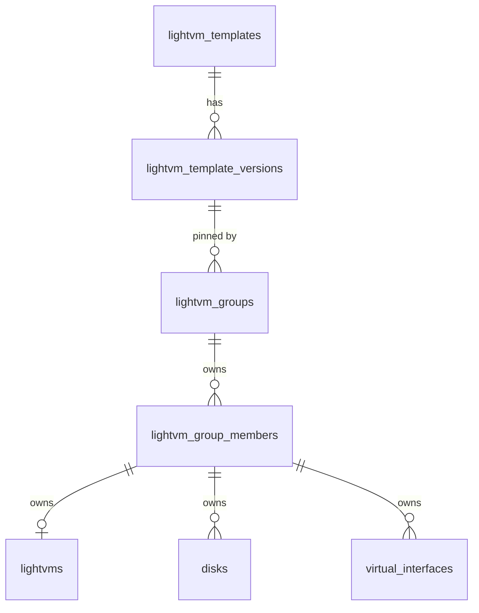

# LightVM Templates and Managed Groups

*   **Author:** Rookery maintainers
*   **Status:** Proposed
*   **Date:** 2026-11-24
*   **Revision:** 6 — shared lifecycle and stable member revision

**Revision note.** The fleet reuses the existing LightVM lifecycle:
`createLightVMDefinition` + `StartLightVM`/`StopLightVM`/`DeleteLightVM`,
`StartCoordinator`, `runMu`, `lifecycle_generation`, and string UUIDs. Member
rows are stable while a group exists; a missing workload is repaired in place
under the member’s own template version. Failed creates/repairs stay
`provisioning` with backoff instead of deleting the row. Force uses the existing
stop path and refuses to clear ownership while QEMU is still running. The first
release remains image-backed LightVM groups only.

--------------------------------------------------------------------------------

## Overview

Rookery treats every LightVM as a hand-assembled record. An operator creates
interfaces first, then creates the LightVM with their IDs. Creation starts QEMU
immediately, and a failure rolls the record back. Nothing records that ten
workers were meant to be identical, how many should exist, or which resources
belong to that fleet.

This design adds two records:

*   **LightVM templates** hold the specification used to create a member: CPU,
    memory, cgroup class, kernel, initramfs, container image, environment,
    executable, consoles, read-only host shares, data disks, and interfaces.
    Specifications are versioned. Editing a specification creates a new
    version.
*   **LightVM groups** pin one template version, carry an operator-set
    `desired_count`, and own their members. A bounded worker creates members
    until the count is met, repairs members whose workload disappeared, restarts
    members whose stored power state is `running`, and reports drift.

The first release is **image-backed LightVM groups**. A group template must set
a digest-qualified container image. Disks are optional blank data disks; the
guest root filesystem comes from the image. Disk-backed group members and VM
groups are deferred.

Ownership is recorded on existing inventory:

*   `lightvms`, `disks`, and `virtual_interfaces` carry a nullable
    `group_member_id`.
*   `lightvm_group_members` is one row per member. It records the group, member
    name, template version, lifecycle state, power state, and retry state.
*   The workload’s `group_member_id` is the authoritative link. Recovery and
    cleanup query by owner, not by name.
*   `lightvms.group_member_id` is `ON DELETE RESTRICT`; owned disks and
    interfaces are `ON DELETE SET NULL`, so a queued kouja delete does not block
    member-row deletion.

A member row is stable for its lifetime. If its LightVM disappears, the worker
repairs the same member with fresh disks and interfaces, using the member’s own
template version. It does not delete the member row and create a new one. Failed
creates and repairs stay `provisioning` with error/backoff; the row is deleted
only by scale-in or group deletion. This preserves the stored power state and
keeps the tracked count stable.

Member power has one owner: global autostart skips group-member LightVMs; the
fleet worker starts, stops, and restarts them. The member row’s `desired_state`
is authoritative. An explicit stop keeps a member stopped, including after a
repair.

Readiness is QEMU-level. A member counts as running when Rookery’s reconciled
LightVM status is `running`. The design does not verify guest health.

The word “template” is already used for cloneable disk images. This document
calls the new records **LightVM templates** and does not change disk templates.

--------------------------------------------------------------------------------

## The Problem

Creating more than one similar LightVM is manual and inconsistent:

*   Every member needs its own interface. Interfaces are single-owner VPP
    objects with generated MAC addresses, network bindings, ACL assignments, and
    route-table defaults. Reusing an interface ID fails on the second create.
*   Every member may need its own data disks. Disks are first-class inventory
    with a backend, size, throttling, and deletion rules.
*   LightVM creation starts QEMU immediately. A partially completed manual setup
    appears as a failed create, not as a queued member.
*   There is no entity that answers “what should this fleet look like” or “how
    many members should exist.” `entity_labels` groups records for filtering but
    has no desired count and no reconciliation.
*   API startup autostarts LightVMs whose `desired_state` is `running`, but that
    is global and has no notion of a fleet, a template, or a missing member.
*   When a member is deleted by mistake, nothing restores the intended size.

A template that names existing interface or disk IDs can produce exactly one
member. The specification must describe how to produce fresh resources.

AWS separates launch templates from Auto Scaling groups. GCP separates instance
templates from managed instance groups. Rookery follows the same split: a
template is data, and a group is a controller that consumes a pinned version.

--------------------------------------------------------------------------------

## Goals

*   Add a LightVM template with a versioned specification. Creating a template
    requires a specification and creates version 1. Editing a specification
    creates a new version. A group pins one version for new members, and each
    member records the version that created it.
*   Let a group move to another version of the same template through an explicit
    update. Existing members keep their version and specification; repair uses
    the member’s version, not the group’s current pin.
*   Require a digest-qualified container image in group templates. Template
    disks are optional blank data disks; disk-backed group members are rejected.
*   Create one vhost-user interface per network entry for each member, with the
    template’s ordered ingress and egress ACL assignments. The interface
    inherits the network’s route-table binding.
*   Create one blank disk per storage entry for each member from the selected
    backend and size. Host passthrough, read-only, and disk-template clone
    entries are rejected in group templates.
*   Add LightVM groups with create, read, list, update, and delete operations.
    `desired_count` accepts zero and is capped at 1024 as an input bound.
*   Record ownership with a nullable `group_member_id` on `lightvms`, `disks`,
    and `virtual_interfaces`. Query by owner for recovery and cleanup.
*   Give member power one owner. Global autostart skips group members; the fleet
    worker starts, stops, and restarts them. The member row stores the power
    state, and a repair uses it.
*   Reuse the existing LightVM lifecycle for every start, stop, and delete:
    `createLightVMDefinition`, `StartLightVM`, `StopLightVM`, `DeleteLightVM`,
    `StartCoordinator`, `runMu`, and `lifecycle_generation`. Do not create a
    second start path.
*   Run fleet work in a bounded worker with its own context. The worker starts
    unconditionally, runs provisioning/repair/cleanup without the VPP epoch, and
    gates creates, starts, and interface writes on a per-phase VPP epoch.
*   Provide member lifecycle states `provisioning`, `active`, and `removing`.
    Failed creates and repairs stay `provisioning` with backoff; they do not
    delete the member row.
*   Publish `desired_count`, `actual_count`, `running_count`, `drift`,
    `provisioning_count`, `removing_count`, and `converged`. Counts come from
    member rows and stored LightVM status, not per-member QMP probes.
*   Reconcile this way:
    *   create members until the tracked member count equals `desired_count`;
    *   repair a member whose LightVM disappeared, using the same member row,
        the member’s version, and its stored power state;
    *   adopt or restart a `provisioning` member that already has a LightVM;
    *   restart a member whose `desired_state` is `running` and whose runtime is
        gone, unless the group is paused or the member backoff is active;
    *   stop a member whose `desired_state` is `stopped` and whose runtime is
        still live;
    *   never delete a failed member row outside scale-in or group deletion;
    *   record group and member errors, backoff, and the last reconcile time.
*   Scale in toward the tracked count. Remove failed `provisioning` members
    with no LightVM first, then the newest active members; never remove a healthy
    active member while a failed member occupies the excess.
*   Reuse the disk deletion path. A kouja `202 deleting` is success;
    `storage.Reclaimer` owns remote cleanup; the member row can be deleted
    because owned disks/interfaces are `ON DELETE SET NULL`.
*   Validate referenced inventory at template version creation, group create,
    group version change, and member provisioning. Pause and `desired_count`
    decreases skip reference validation. Do not add inventory deletion guards.
*   Expose LightVM templates, versions, and groups through two Terraform
    resources: `rookery_lightvm_template` and `rookery_lightvm_group`. The
    template resource carries the current specification, creates a version only
    in Create/Update, and exposes `current_version_id` and `latest_version_id`.
*   Reject writable virtiofs shares and disk-backed group templates.
*   Make group ownership visible on LightVM responses and in the UI. Reject
    definition updates for a group member; allow start, stop, console, member
    start/stop actions, and delete. A direct delete of a member’s LightVM
    triggers repair.

--------------------------------------------------------------------------------

## Non-Goals

*   VM templates and VM groups. Deferred until a prepared-content path exists.
*   Disk-backed LightVM group members (empty image, root from a disk). Deferred.
*   Guest-level health checks, boot verification, liveness probes, or readiness
    probes. Readiness means the reconciled LightVM status is running.
*   Automatic replacement of a member row that keeps failing to start. It stays
    `provisioning`/`active` with an error until an operator deletes its workload
    or the group.
*   Metric-based autoscaling, scheduled scaling, cooldowns, or hysteresis.
*   Capacity admission. The 1024 count cap is an input bound, not a guarantee.
    Thin-pool and host-memory exhaustion are reported per member and retried with
    backoff.
*   Stable member names, ordinals, or identity across scale-in/new members. A
    repaired member keeps its name; a new member gets a new name.
*   Template-only creation of a single LightVM outside a group.
*   Writable virtiofs shares in templates. Host-directory shares are read-only.
*   Disk-template cloning or image seeding for data disks. Group data disks are
    blank.
*   Hot-resizing or reconfiguring an existing member when the group moves to a
    new version.
*   Correcting a member edited outside the group. Definition updates are
    rejected.
*   Running more than one API server against the same database.
*   Deletion guards for inventory referenced by a pinned version.
*   Per-group batch size control.
*   A version-delete API. Deleting a template is allowed only when no group pins
    it; versions cascade.
*   VPP-free deletion of interfaces. Interface deletion still requires VPP;
    cleanup backs off, and force can release ownership without deleting the VPP
    object.

--------------------------------------------------------------------------------

## Design Decisions

*   **LightVM-only first release.** Image-backed LightVM groups are in scope; VM
    and disk-backed LightVM groups are deferred.
*   **Stable member identity.** A disappeared LightVM is repaired under the same
    member row with fresh resources and the member’s version. The row is not
    deleted until scale-in or group deletion.
*   **Failed provisioning stays provisioning.** A failed create or repair keeps
    the member row and retries with backoff; it never deletes the row or loses
    power intent.
*   **Member power is authoritative.** `lightvm_group_members.desired_state` is
    the source of truth; the LightVM row mirrors it. Start/stop actions write the
    member first and then use the existing LightVM lifecycle.
*   **Reuse the lifecycle.** The fleet calls the same
    `createLightVMDefinition`/`StartLightVM`/`StopLightVM`/`DeleteLightVM` paths
    as the public API. It does not call the runtime directly.
*   **Release `resourceMu` before image pull.** The shared create definition
    helper unlocks after the store insert; `StartLightVM` uses the start
    coordinator and lifecycle generation for cancellation.
*   **Force is safe, not a kill guarantee.** Force uses the existing
    `StopLightVM`; if QEMU remains alive, the member stays `removing` with an
    error. If QEMU stopped but cleanup fails, force clears the workload owner
    and leaves an explicit orphan.
*   **Templates pin image content.** Group templates require a
    digest-qualified image (`@sha256:...`); tag-only image references are
    rejected.
*   **Terraform uses two inline-spec resources.** No version resources. `Read`
    is read-only; versions are created only in Create/Update.
*   **`wait_for_ready` defaults to false.** It is opt-in for fully running,
    converged fleets; stopped members and paused groups otherwise time out by
    design.
*   **Capacity admission is not implemented.** The 1024 count cap, per-member
    failure, and backoff limit the blast radius.

--------------------------------------------------------------------------------

## Open Questions

None.

--------------------------------------------------------------------------------

## Critical User Journeys (CUJs)

### CUJ 1: Create a LightVM fleet from a template

*   **Given**: A ready storage backend, a Rookery Network, ACLs, uploaded
    kernel/initramfs images, and a digest-qualified container image.
*   **When**: The operator creates a LightVM template with 2 vCPUs, 2048 MiB,
    one data disk, and one interface, then creates a group with
    `desired_count = 3`.
*   **Then**: The group returns `201` with `actual_count=0` and
    `converged=false`, and the worker converges asynchronously. After
    convergence, three members exist; each has its own data disk, interface,
    generated MAC address, and QEMU process. The group reports `actual_count=3`,
    `running_count=3`, `drift=0`, `converged=true`. `wait_for_ready` or a client
    poll observes the final state.

### CUJ 2: Restart a crashed member

*   **Given**: A group with three running members whose `desired_state` is
    `running`.
*   **When**: One member’s QEMU process disappears without an operator stop, but
    the LightVM record remains.
*   **Then**: The fleet starts the same member again through `StartLightVM`. It
    does not create a new member, disk, or interface.

### CUJ 3: Honor an explicit stop

*   **Given**: The same group.
*   **When**: The operator stops one member through
    `POST /api/lightvm/instances/{id}/stop` or the member stop action.
*   **Then**: The member’s `desired_state` becomes `stopped` and is stored before
    the workload is stopped. The fleet leaves it stopped. `running_count` drops
    by one; `actual_count` and `drift` stay the same. Starting the member
    restores it.

### CUJ 4: Repair an out-of-band member delete

*   **Given**: A group with three running members on template version 1, one of
    which is stopped.
*   **When**: An operator deletes the stopped member’s LightVM through
    `DELETE /api/lightvm/instances/{id}`.
*   **Then**: The member row remains and its `desired_state` stays `stopped`. The
    fleet marks the member `provisioning`, deletes its owned interfaces and
    disks, creates fresh ones from **the member’s version 1**, creates a new
    LightVM under the same `group_member_id`, and leaves it stopped. The member
    keeps its name and version; `actual_count` returns to 3 and `running_count`
    remains 2.
*   **And**: The UI delete confirmation warns that a group member is repaired
    with fresh disks and is not removed from the group.

### CUJ 5: Scale in

*   **Given**: A group with three active members and owned resources.
*   **When**: The operator sets `desired_count = 1`.
*   **Then**: The fleet marks exactly two active members `removing`, stops them,
    deletes their interfaces and disks, and reports `actual_count=1`,
    `removing_count=0`, `converged=true`.

### CUJ 6: Delete a group

*   **Given**: A group with three active members and owned resources.
*   **When**: The operator deletes the group without force.
*   **Then**: The API returns `202` with `state="deleting"`. The fleet removes the
    members and deletes the group; a client polls until `404`.
*   **And**: An empty group is deleted synchronously and returns `204`. Force on
    an empty group also returns `204`.

### CUJ 7: Move a group to a newer template version

*   **Given**: A group pinned to version 1 with three members.
*   **When**: The operator creates version 2 with 4096 MiB and moves the group to
    version 2, then raises `desired_count` to 4.
*   **Then**: Existing members remain at 2048 MiB and report version 1. The new
    member is created with 4096 MiB and reports version 2. Repairing an existing
    version 1 member after the move keeps version 1.

### CUJ 8: Provisioning fails during scale-out

*   **Given**: A group needs one more member, but the storage backend rejects the
    disk request.
*   **When**: The fleet tries to create the member.
*   **Then**: No partial LightVM, orphan interface, or orphan disk remains after
    cleanup. The member stays `provisioning` with an error and backoff; it does
    not delete the member row. `actual_count` stays below `desired_count` and
    `converged=false`. The same member retries on a later pass.

### CUJ 9: A kouja disk cannot be deleted

*   **Given**: A member uses a kouja data disk that reaches `delete_failed`.
*   **When**: the group is deleted.
*   **Then**: The fleet deletes the workload, requests disk deletion once, and
    removes the member row. The disk’s `group_member_id` becomes NULL, and the
    disk remains visible in inventory. `storage.Reclaimer` owns the remote
    volume. A forced delete behaves the same way and never clears ownership
    while QEMU is still running.

--------------------------------------------------------------------------------

## Technical Plan (Architecture)

### 1. Terms and Boundaries

| Term | Meaning |
| --- | --- |
| LightVM template | The named record that holds the history of a LightVM specification. |
| Template version | One immutable, numbered specification. Editing a specification creates a new version. |
| Group record | The row in `lightvm_groups`: pinned version, desired count, pause/delete state, last reconcile/error. |
| Member | One row in `lightvm_group_members`: group, member name, version, lifecycle state, power state, retry state. |
| Workload | The member’s LightVM (`lightvms` row). It is not a disk or interface. |
| Owned resource | A disk or vhost-user interface whose `group_member_id` points at a member. |
| Fleet worker | The bounded background loop that reconciles groups. It is not the group record. |
| Tracked count | `COUNT(*)` of member rows for a group, regardless of state. |
| Active count | Members with a LightVM, regardless of member state. |
| Running count | Members whose LightVM stored `status` is `running`. |
| Provisioning count | Members in `provisioning`. |
| Removing count | Members in `removing`. |
| Drift | `desired_count - actual_count`. Configuration differences use “configuration divergence.” |
| Converged | `actual_count == desired_count`, `provisioning_count == 0`, and `removing_count == 0`. |
| Fleet epoch | A counter incremented after the gated VPP network/interface/ACL/route-table phase succeeds and reset on a VPP reset or gated-phase failure. |
| Start coordinator | `lightvm.StartCoordinator`, which serializes a LightVM’s start and gates cleanup against starts. |
| Lifecycle generation | `lightvms.lifecycle_generation`, incremented by start/stop/update/delete transitions; starts abort when it changes. |

Templates are data. The group record is data. The fleet worker is the only code
that reconciles members. Direct create APIs remain independent for unmanaged
LightVMs.

### 2. Data Model

Migration `internal/store/migrations/0061_lightvm_templates_and_groups.sql` adds
four tables and three nullable ownership columns.



| Table | Purpose | Key columns |
| --- | --- | --- |
| `lightvm_templates` | Named template metadata. | `id`, `name` unique, `description`, timestamps. |
| `lightvm_template_versions` | Immutable specifications. | `template_id`, `version`, `spec` JSON, `UNIQUE(template_id, version)`. |
| `lightvm_groups` | Desired state and deletion. | `template_version_id`, `desired_count`, `paused`, `force_delete`, `state`, `last_reconcile_at`, `last_error`, retry fields. |
| `lightvm_group_members` | Stable member identity. | `group_id`, `member_name` unique, operational version fields, `state`, `desired_state`, retry fields. |
| `lightvms` | Workload. | Adds `group_member_id` (`RESTRICT`); partial unique index. |
| `disks` | Owned data disk. | Adds `group_member_id` (`SET NULL`). |
| `virtual_interfaces` | Owned interface. | Adds `group_member_id` (`SET NULL`). |

The full DDL is in the Detailed Plan. The invariants are:

*   Template names, group names, and member names are unique and
    case-insensitive. Member names are generated by the server.
*   A template version row is immutable. No update RPC exists.
*   A group pins exactly one version for new members.
*   A member records the version that created it. Those fields are operational,
    not informational: repair uses them. The version row can be deleted only by
    template deletion, which is blocked while a group pins the template.
*   A member owns at most one LightVM. The partial unique index on
    `lightvms(group_member_id)` enforces this.
*   Member states are `provisioning`, `active`, and `removing`.
*   `desired_count` is 0–1024. Zero is the scale-to-empty state.
*   `paused` suppresses creates and starts. Scale-in, repair, cleanup, stop, and
    group deletion continue.
*   `force_delete` is idempotent and allowed in `active` or `deleting`.
*   `actual_count` is the number of members with a LightVM. `running_count` is
    the number whose stored LightVM status is `running`. `provisioning_count`
    and `removing_count` count member states. `converged` is defined above.
*   Timestamps are Unix milliseconds. Zero means “never” or “eligible”; API
    timestamps omit zero values.

`ON DELETE SET NULL` on owned resources is deliberate: a kouja delete leaves the
disk row `deleting`, and the member row must be deletable without waiting for the
reclaimer. The disk remains visible in inventory as unowned. The `lightvms` FK
is `RESTRICT`; the workload must be deleted (or its owner cleared by force
after QEMU stops) before its member row.

#### State Transitions

```text
                +----------------+
                |  provisioning  |
                +----------------+
                  |            |
            success           failure
                  v            v
             +---------+  +----------------+
             | active  |  | provisioning   |
             +---------+  | error/backoff  |
               |    |     +----------------+
  operator     |    |             ^
  delete/repair|    | scale-in    |
               v    +-------------+
          +---------+
          | removing|
          +---------+
               |
          cleanup complete
               v
       (member row deleted)
```

A create/repair failure stays `provisioning` with error/backoff; it does not
delete the row. An `active` member whose LightVM disappears or is deleted for
repair moves back to `provisioning`, then returns to `active` after adoption or
repair. A start failure after the LightVM exists leaves the member `active` with
an error and backoff. A cleanup conflict stays `removing` with an error and
backoff until an operator resolves it or force deletes the group.

### 3. API Surface

#### 3.1 Services

| Service | RPCs |
| --- | --- |
| `LightVMTemplateService` | `ListLightVMTemplates`, `GetLightVMTemplate`, `CreateLightVMTemplate`, `UpdateLightVMTemplate`, `DeleteLightVMTemplate`, `ListLightVMTemplateVersions`, `GetLightVMTemplateVersion`, `CreateLightVMTemplateVersion` |
| `LightVMGroupService` | `ListLightVMGroups`, `GetLightVMGroup`, `CreateLightVMGroup`, `UpdateLightVMGroup`, `DeleteLightVMGroup`, `StartLightVMGroupMember`, `StopLightVMGroupMember` |

`UpdateLightVMTemplate` is metadata-only: it accepts `name` and `description`.
Specification changes use `CreateLightVMTemplateVersion`. There is no
version-delete RPC.

#### 3.2 HTTP Paths and Status Codes

| Method | Path | Result |
| --- | --- | --- |
| `GET` | `/api/lightvm/templates` | 200, `templates` |
| `GET` | `/api/lightvm/templates/{id}` | 200, template |
| `POST` | `/api/lightvm/templates` | 201, template, `Location` |
| `PUT` | `/api/lightvm/templates/{id}` | 200, metadata |
| `DELETE` | `/api/lightvm/templates/{id}` | 204 |
| `GET` | `/api/lightvm/templates/{id}/versions` | 200, `versions` |
| `POST` | `/api/lightvm/templates/{id}/versions` | 201, version, `Location` |
| `GET` | `/api/lightvm/templates/{id}/versions/{version_id}` | 200, full version |
| `GET` | `/api/lightvm/groups` | 200, `groups` |
| `GET` | `/api/lightvm/groups/{id}` | 200, group with members |
| `POST` | `/api/lightvm/groups` | 201, group, `Location` |
| `PUT` | `/api/lightvm/groups/{id}` | 200, group |
| `DELETE` | `/api/lightvm/groups/{id}` | 204 if empty, 202 if members remain |
| `DELETE` | `/api/lightvm/groups/{id}?force=true` | 204 if empty, 202 if members remain |
| `POST` | `/api/lightvm/groups/{id}/members/{member_id}/start` | 200, member |
| `POST` | `/api/lightvm/groups/{id}/members/{member_id}/stop` | 200, member |

Group create/update/delete messages:

```text
CreateLightVMGroupRequest {
  string name;
  string description;
  int64  template_version_id;
  uint32 desired_count;        // 0..1024
  optional bool paused;
}

UpdateLightVMGroupRequest {
  int64  id;
  optional string name;
  optional string description;
  optional int64  template_version_id;
  optional uint32 desired_count;
  optional bool   paused;
}

DeleteLightVMGroupRequest {
  int64 id;
  bool  force;                 // query parameter
}

ListLightVMGroupsResponse { repeated LightVMGroup groups; }
GetLightVMGroupResponse  { LightVMGroup group; }

DeleteLightVMGroupResponse {
  string state;                // "deleted" for 204, "deleting" for 202
}

StartLightVMGroupMemberRequest { int64 id; int64 member_id; }
StopLightVMGroupMemberRequest  { int64 id; int64 member_id; }
GetLightVMGroupRequest        { int64 id; }
ListLightVMGroupsRequest      {}
```

Template requests/responses:

```text
CreateLightVMTemplateRequest {
  string name;
  string description;
  LightVMTemplateSpec spec;
}
UpdateLightVMTemplateRequest {
  int64  id;
  optional string name;
  optional string description;   // metadata only
}
DeleteLightVMTemplateRequest { int64 id; }
GetLightVMTemplateRequest    { int64 id; }
ListLightVMTemplatesRequest  {}
ListLightVMTemplatesResponse { repeated LightVMTemplate templates; }

CreateLightVMTemplateVersionRequest {
  int64 id;                    // template ID in the path
  LightVMTemplateSpec spec;
}
GetLightVMTemplateVersionRequest {
  int64 id;                    // template ID in the path
  int64 version_id;
}
ListLightVMTemplateVersionsRequest  { int64 id; }
ListLightVMTemplateVersionsResponse {
  repeated LightVMTemplateVersionSummary versions;
}
```

`force=true` on an active group sets `state='deleting'` and
`force_delete=1` in one transaction. On an already-deleting group it only sets
the force flag. Both return `202` when members remain and `204` when the group
was empty and deleted synchronously.

The member-intent insert is conditional on `state='active'`, `paused=0`,
`force_delete=0`, the expected `template_version_id`, and the tracked-count
guard. A losing insert treats the group as changed and stops the pass.

#### 3.3 Message Shapes

Shared entries:

```text
TemplateDiskEntry {
  int64  storage_backend_id;
  int32  size_gb;
  optional int64 throttle_class_id;
  string serial;               // empty = no serial; non-empty <= 20 bytes
  // response-only; not stored
  string storage_backend_name;
  string throttle_class_name;
}

TemplateInterfaceEntry {
  int64 network_id;
  repeated int64 ingress_acl_ids;
  repeated int64 egress_acl_ids;
  // response-only; not stored
  string network_name;
  repeated string ingress_acl_names;
  repeated string egress_acl_names;
}
```

LightVM spec:

```text
LightVMTemplateSpec {
  int32  vcpus;                // required, 1..128
  int32  memory_mb;            // required, 128..1048576
  string cgroup_class;         // empty = shared
  int64  kernel_id;            // required
  int64  initramfs_id;         // required
  string image;                // required; must contain @sha256:
  repeated LightVMEnvVar env;
  string executable_path;
  repeated string executable_args;
  string executable_script;
  string append;               // empty = DefaultLightVMAppend
  bool   console_enabled;
  repeated LightVMConsole consoles; // empty = one console named "console"
  repeated LightVMVirtioFSShare virtiofs_shares; // read_only must be true
  repeated TemplateDiskEntry      disks;          // optional data disks
  repeated TemplateInterfaceEntry interfaces;     // 0..24, combined cap
}
```

`config_files` is intentionally absent: image-backed group templates do not use
the disk-backed config archive. `ephemeral` is absent; group members are always
non-ephemeral. Runtime fields in `LightVMConsole`/`LightVMVirtioFSShare` (IDs,
sockets, ports, positions) are rejected when non-zero/non-empty.

Template records:

```text
LightVMTemplate {
  int64  id;
  string name;
  string description;
  int32  latest_version;
  int64  latest_version_id;
  int32  version_count;
  Timestamp created_at;
  Timestamp updated_at;
}

LightVMTemplateVersion {
  int64  id;
  int64  template_id;
  int32  version;
  LightVMTemplateSpec spec;
  Timestamp created_at;
}

LightVMTemplateVersionSummary {
  int64  id;
  int64  template_id;
  int32  version;
  int32  vcpus;
  int32  memory_mb;
  int32  disk_count;
  int32  interface_count;
  Timestamp created_at;
}
```

Group records:

```text
LightVMGroup {
  int64  id;
  string name;
  string description;
  int64  template_id;
  string template_name;
  int64  template_version_id;
  int32  template_version;
  uint32 desired_count;
  uint32 actual_count;         // members with a LightVM
  uint32 running_count;        // stored LightVM status == running
  uint32 provisioning_count;
  uint32 removing_count;
  int32  drift;                // desired_count - actual_count
  bool   converged;            // actual==desired && provisioning==0 && removing==0
  bool   paused;
  string state;                // active | deleting
  Timestamp last_reconcile_at; // omitted when zero
  string last_error;
  repeated LightVMGroupMember members; // empty in List
  Timestamp created_at;
  Timestamp updated_at;
}

LightVMGroupMember {
  int64  id;
  string name;
  string workload_id;          // derived from lightvms.group_member_id
  string state;                // provisioning | active | removing
  int32  template_version;
  string status;               // LightVM status, or "missing"
  string desired_state;        // stored member power intent
  string last_error;
  Timestamp next_retry_at;     // omitted when zero
  Timestamp created_at;
  Timestamp updated_at;
}
```

Existing `LightVM` responses gain `group_id` and `group_name` (0/empty when
unmanaged). They are populated in `ListLightVMs`, `GetLightVM`, and action
responses via a join on `lightvms.group_member_id`.

#### 3.4 Validation and Error Mapping

| Area | Rule |
| --- | --- |
| Names | Template, group, and member names use `[A-Za-z0-9][A-Za-z0-9._-]*`, 1–64 characters; case-insensitive unique. Member names are generated. |
| Compute | `vcpus` 1–128, `memory_mb` 128–1048576; both required in a spec. |
| Cgroup | Empty selects the shared cgroup. Non-empty must exist and be a leaf at version creation and member provisioning. Pause/count-decrease updates skip reference validation. |
| Boot | Kernel, initramfs, and a non-empty image are required. The image must match `@sha256:[0-9a-f]{64}`; tag-only or short-digest references are rejected. Disk-backed group templates (empty image) are rejected. |
| Storage | Optional data disks, max 24 combined with interfaces and shares. Backend `lvm-thin` or `kouja`; size 1–65536; throttle class exists; blank only. Serials: empty allowed; non-empty <= 20 bytes, `[A-Za-z0-9._:-]`, unique; `rookery-config` reserved. |
| Interfaces | Combined cap `min(24, 24 - disks - shares)`; network exists; ACL IDs exist, deduped, order preserved; interface inherits network route table. |
| LightVM fields | Exactly one of `executable_path` or `executable_script` for an image-backed definition; args require a path; env limits match `CreateLightVM`; `config_files` are not part of a template. |
| Consoles | 1–32 unique names; empty means one `console`. |
| Shares | Absolute host paths, unique tags, `rootfs` reserved, `read_only` true. |
| Group | Version exists; `desired_count` 0–1024. Pause/count decreases skip reference validation; a version change or count increase revalidates. |
| Group update | Rejected while deleting. Same template only; a version from another template is rejected. |
| Group delete | Empty: 204 in one transaction. Non-empty: 202. `force` is idempotent and allowed in active/deleting. |
| Member actions | Definition updates via `PUT /api/lightvm/instances/{id}` are rejected. Start, stop, console, and delete are allowed. Group member start/stop actions update member intent; start is rejected while the group is paused or deleting. |
| Display fields | Backend/network/ACL names are response-only, stripped from stored JSON, empty when a referenced object is missing. |

Error mapping:

| Condition | gRPC code | HTTP |
| --- | --- | --- |
| Duplicate template/group/member name | `AlreadyExists` | 409 |
| Missing record | `NotFound` | 404 |
| Bad spec, missing reference | `InvalidArgument` | 400 |
| Delete template while pinned, update group while deleting, bad version/template | `FailedPrecondition` | 400 |
| Attachment conflict / resource owned by another member | `Aborted` | 409 |
| VPP not ready for a member create/start | `Unavailable` | 503 |
| Store failure | `Internal` | 500 |

Fleet retryability is by condition: `Unavailable`, `Internal`, and kouja
`SESSION_ACTIVE` are retryable. `InvalidArgument` and `FailedPrecondition`
record an error and back off without deleting the member row. `AlreadyExists`
and permanent `Aborted` conflicts set an error/backoff; the operator resolves the
resource or force deletes the group. A clean pass clears the group error; a
successful member start or cleanup clears the member error.

### 4. Provisioning and Reconciliation

#### 4.1 Worker, Shared Interfaces, Epoch, and Budget

The worker uses a small shared package:

```text
package fleet

type Guard interface {
    Epoch() uint64
    CanProvision(epoch uint64) bool
}

type Reconciler interface {
    ReconcileFleet(ctx context.Context, guard Guard) error
    WakeFleet()
    FleetWake() <-chan struct{}
}
```

`internal/fleet` imports only `context`; `api` and `gateway` both import it.
There is no package cycle and no duplicate named interface type.

`internal/api.Server` owns:

*   an `atomic.Uint64` fleet epoch;
*   a VPP-network-ready flag;
*   a `fleet.Reconciler` configured by `SetFleetController`;
*   the `fleet.Guard` implementation.

`RunFleetReconciler(ctx)` starts unconditionally from `serve`. It waits on a
five-second ticker or the wake channel and calls
`ReconcileFleet(ctx, s)`. `WakeFleet` is a coalescing, non-blocking send to a
buffered size-1 channel; group CRUD and member actions never block on an
in-flight pass. At pass start the worker captures `epoch := s.Epoch()`. The
controller calls `guard.CanProvision(epoch)` before every create, interface
write, and member start; provisioning/repair resource cleanup, stop, and
group-row deletion do not require it. If the epoch changes during a pass, the
controller finishes the current cleanup and returns without starting more
creates.

`reconcileInfrastructure` is split:

*   **Gated VPP network phase:** networks, network pipes, host taps, vhost-user
    interfaces, route tables, ACLs, host interfaces, VPP interface addresses,
    and VPP interface route tables. On success, increment the fleet epoch and
    set the ready flag. On any failure, set the ready flag false and the epoch to
    0. On a VPP pending reset or identity change, do the same.
*   **Non-gated phase:** NAT44, VNFs, VNF bindings, and other infrastructure.
    Their failures do not block fleet creates.
*   **Autostart:** `autostartVMs` and `autostartLightVMs` run after the VPP
    network phase, as today. They skip group-member LightVMs.

Worker limits:

*   `fleetMaxActionsPerPass = 10`, counting every state-changing member action
    across all groups in one pass: missing-to-provisioning marking, repair,
    cleanup/removal, stop, restart, and create. Read-only status reconciliation
    is free; it does not consume budget.
*   `fleetPassTimeout = 30m`. `ReconcileFleet` derives
    `passCtx, cancel := context.WithTimeout(ctx, fleetPassTimeout)` and passes
    it to every action; the budget and deadline are checked before each action,
    not only between groups.
*   `fleetMemberTimeout = 15m` for a create/start action.
*   `fleetCleanupTimeout = 10m` for ordinary cleanup.
*   `fleetForceCleanupTimeout = 2m` for force cleanup.
*   `fleetStabilityWindow = 10s` before a successful start clears attempts.

A large group can consume the budget; later groups wait for the next pass. This
is deliberate: the total work per pass is bounded. Fairness across groups is
future work.

#### 4.2 Shared LightVM Lifecycle

The fleet does not call the runtime. It uses the same service helpers as the
public API:

```text
createLightVMDefinition(ctx, vm) (store.LightVM, error)
    validate references/cgroup
    resourceMu.Lock
    store.CreateLightVM
    resourceMu.Unlock
    return created

CreateLightVM (public)
    created := createLightVMDefinition
    if runtime != nil: StartLightVM
    on start failure: DeleteLightVM(cleanup)

Fleet member create/repair
    created := createLightVMDefinition(vm with group_member_id, member desired_state)
    if member.desired_state == running && not paused/deleting:
        startLightVMInternal(ctx, created.ID) // same coordinator/lifecycle
```

`createLightVMDefinition` sets `status=stopped` and the desired state supplied by
the member. `StartLightVM` uses `StartCoordinator.Begin`, `resourceMu`-free
prepare/start, `runMu`/`s.mu`, `LifecycleGeneration`, and the valid statuses
`starting`/`running`/`error`. There is no `creating` status and no second start
path.

`StartLightVM` rechecks the row, desired state, and lifecycle generation after
`PrepareLightVM`. A concurrent stop/delete increments the generation and cancels
the preparation. `DeleteLightVM` and `StopLightVM` use
`StartCoordinator.Reserve`/`Cancel`, so a force or repair can cancel an in-flight
start.

After `StartLightVM` returns, the fleet re-reads the group and member. If the
group is deleting/force-deleting, or the member is `removing`/stopped, the fleet
calls `StopLightVM` and, if force, continues cleanup. A start that completes just
before force is stopped by force cleanup; it cannot survive as a live member.

#### 4.3 Member Creation, Recovery, and Repair

Member creation:

1.  Insert the member with the tracked-count guard and `desired_state`.
2.  Create owned disks (LVM: create LV then insert; rollback the LV on insert
    failure; kouja: existing provisioning state) and interfaces.
3.  Create the LightVM definition with `group_member_id`, `status=stopped`, and
    the member’s desired state.
4.  If desired running and the group is active/unpaused, call `StartLightVM`.
    If the start fails, the LightVM remains `error`; the member is `active` with
    error/backoff and retries the start. If desired stopped, mark the member
    `active` after the definition is inserted; no start is required. The member
    row is not deleted.
5.  On definition/resource failure, clean up and keep the member `provisioning`
    with error/backoff.

Recovery for a `provisioning` member:

*   **No LightVM:** repair. Delete owned resources that are not attached to an
    orphan, create fresh interfaces/disks from the member’s
    `template_version_id` with a four-hex repair suffix, create a LightVM
    definition under the same member, then start it if the member is running and
    the group allows starts. Mark `active`. A kouja disk still
    `deleting`/`delete_failed` keeps its old name and stays owned until the
    member row is deleted or the reclaimer finishes; the new disk uses the
    suffix and does not collide.
*   **LightVM exists:** adopt it. If the stored status is `running`, mark active.
    If desired running and status is `stopped`/`error`/`starting`, call
    `StartLightVM` unless the group is paused/deleting; on success mark
    active/running, on failure mark active/error and back off. If desired stopped
    and QEMU is live, call `StopLightVM` and mark active after it succeeds. If
    desired stopped and QEMU is not live, mark active immediately; no start is
    required. If owned attachments do not match the LightVM’s attachments,
    delete the LightVM, clean owned resources, and repair. A stopped-intent
    member with an existing stopped LightVM must never remain `provisioning`.
*   **Crash windows:** the member remains `provisioning` until the row and
    workload are consistent. A crash after the definition insert, after prepare,
    or after QEMU start is recovered by the adopt path.

Repair uses the member’s version fields, not the group’s current pin. Moving a
group to version 2 does not upgrade a version 1 member that is repaired later.

#### 4.4 Cleanup, Scale-In, and Force

Ordinary cleanup:

1.  `StopLightVM` if live; then `DeleteLightVM` (both existing paths). Treat
    `ErrLightVMNotFound` from either as already gone. If `DeleteLightVM` fails
    after QEMU stopped, retry with backoff; do not clear ownership in normal
    cleanup.
2.  Delete interfaces with `group_member_id = member.id` through the existing
    `DeleteInterface` path. VPP must be ready and the gated epoch must be
    current; during a VPP rebuild (readiness true but vhost indices not yet
    reconciled), verify the interface by name or skip and back off. Never delete
    a VPP object using a stale `sw_if_index`. If VPP is unavailable, the member
    stays `removing` with an error and retries later.
3.  Delete disks with `group_member_id = member.id`. LVM/host deletes are
    synchronous. A kouja `202 deleting` is success; the member row is deleted
    without waiting, and the disk’s owner becomes NULL when the member row is
    deleted. `storage.Reclaimer` owns the remote volume. Do not call delete again
    for a disk already `deleting`/`delete_failed`.
4.  Delete the member row when no owned resources remain, or when force clears
    the remaining owners.

Scale-in uses `tracked - desired_count - removing_count` as the excess. It first
marks failed `provisioning` members with no LightVM `removing`, then the newest
active members by `created_at DESC, id DESC`, up to the remaining budget. A
healthy active member is not removed while a failed member occupies the excess.
This makes `desired_count = 0` truly scale to empty, including members whose
create/repair kept failing.

Force:

*   `force_delete` is set atomically with `state='deleting'` by the delete
    request. It is idempotent and allowed in `active` or `deleting`.
*   The worker checks `state='deleting'` before repair/recovery/create. The
    member-intent insert rejects `force_delete=1`.
*   Force marks every non-removing member `removing` and processes them with
    `fleetForceCleanupTimeout`.
*   For each member, it calls the existing `StopLightVM`. If QEMU is still
    running after stop returns or errors, the member stays `removing` with an
    explicit “QEMU still running” error; force does **not** clear ownership or
    delete the group while a QEMU is alive. This prevents a live orphan.
*   Once QEMU is stopped, force calls `DeleteLightVM` (treat not-found as
    already gone). If cleanup still fails, it sets the LightVM
    `desired_state=stopped` and status `error`, clears
    `lightvms.group_member_id`, records the orphan, and leaves the LightVM row in
    inventory. The orphan keeps its disk/interface attachments; force must not
    delete resources attached to that orphan. It deletes only owned resources
    not attached to the orphan, then deletes the member row. Member-row deletion
    sets any remaining resource owner to NULL.
*   Force may leave VPP interfaces behind when VPP is unavailable; they are
    visible inventory and are cleaned up by a later operator/VPP reconciliation.
*   Force on an empty group deletes the row and returns 204; force on a
    non-empty group returns 202. Force does not create or restart anything.

#### 4.5 Reconcile Loop

```text
budget = fleetMaxActionsPerPass
passCtx = context.WithTimeout(ctx, fleetPassTimeout)
for each group (sequential):
    if passCtx.Err() != nil or budget == 0: return
    if group.state == deleting:
        mark every non-removing member removing (each mark costs budget)
        advance removals respecting member.next_retry_at (each costs budget;
            force uses force cleanup)
        if no members remain: delete group row
        continue

    tracked = count(member rows)
    removing_count = count(removing)
    excess = tracked - desired_count - removing_count
    if excess > 0:
        mark failed provisioning (no LightVM) first, then newest active,
            removing (each costs budget; recompute removing_count)
        # Do not repair members selected for removal.

    recover provisioning members that are not removing:
        if now < member.next_retry_at: skip
        if no LightVM: repair (costs budget)
        else: adopt/start/stop (state changes cost budget; status read is free)
    advance removals respecting member.next_retry_at (each costs budget)

    for active members:
        if LightVM missing: mark provisioning (costs budget)
        else: read runtime status (free)
        if desired_state=running and not live and not a live starting operation:
            start (costs budget; guard-gated; check budget/deadline first)
        if desired_state=stopped and live:
            stop (costs budget; check budget/deadline first)

    if paused:
        update last_reconcile_at/error; continue
    if tracked - removing_count < desired_count and now >= group.next_retry_at:
        create min(desired_count - (tracked - removing_count), budget) members
        on member failure: set member retry/backoff; on group validation failure:
            set group retry/backoff; stop creates
    update last_reconcile_at/last_error
```

Every action checks `passCtx.Err()` and the budget before it starts. Status reads
and no-op liveness checks are free. A successful create/repair clears the
member’s `retry_attempts`, `next_retry_at`, and `last_error`; a successful
cleanup clears `cleanup_attempts`; a clean group pass clears the group retry
fields. `group.next_retry_at` is used only for group-level validation failures,
not one member’s storage failure.

The budget is one counter for the whole pass, not one per group. When it reaches
zero, the pass returns and the next tick continues. Counts are computed at read;
the worker does not persist them.

#### 4.6 Power, Pause, and Backoff

*   Member `desired_state` is authoritative. `/start` and `/stop` on a LightVM
    update the member row and LightVM mirror in one store transaction, then call
    `StartLightVM`/`StopLightVM`. If the LightVM row is missing, the member
    start/stop action updates only the member row; the worker repairs it.
*   Group member actions are the supported missing-workload path:
    `POST /api/lightvm/groups/{id}/members/{member_id}/start|stop`. They update
    member intent and wake the worker; they do not start/stop synchronously. This
    keeps a first image pull from exceeding the HTTP write deadline.
*   Direct `/start` on a group member is rejected while the group is paused or
    deleting, or while the member is `provisioning`/`removing`. Direct `/stop`
    is allowed (it is always safe). The fleet’s repair/adoption helper calls the
    internal start wrapper (the same lifecycle) after checking group/member
    state; it does not go through the public member-state guard.
*   Active member liveness is reconciled every pass: if the LightVM exists,
    `desired_state=running`, QEMU is not live, and the status is not a live
    `starting` operation, set the stored status to `stopped`/`error` as
    appropriate and call `StartLightVM` if not paused, guard-ready, and
    `now >= member.next_retry_at`. A `starting` status is treated as in-flight
    only while `StartCoordinator.Busy(lightVMID)` is true; if the coordinator is
    not busy and QEMU is not live, the status is stale and is repaired/restarted.
    If `desired_state=stopped` and QEMU is live, call `StopLightVM` once,
    bounded. This is the CUJ 2 restart path.
*   Classify start results: `AlreadyExists` (QEMU already live) is success and
    heals status/desired; `Aborted` (a stop/delete/intent race) is re-read and
    retried without incrementing attempts; only real failures (`Unavailable`,
    `Internal`, missing reference, kouja session active, `FailedPrecondition`)
    increment `restart_attempts`/backoff. Every `StartLightVM` failure leaves a
    terminal `error`/`stopped` status so the fleet can act.
*   `desired_state=running` and no live process: start if not paused, guard
    ready, and `now >= member.next_retry_at`.
*   `desired_state=stopped` and a live process: stop it once per pass, bounded.
*   `paused`: skip creates and starts; scale-in, repair, cleanup, stop, and
    delete continue.
*   A LightVM paused by QEMU for I/O error counts as running; the worker does not
    resume it.
*   Start failure increments `restart_attempts`, sets
    `next_retry_at = now + min(5s * 2^(attempts-1), 5m)`, and records
    `last_error`.
*   A successful start sets `next_retry_at = now + fleetStabilityWindow` and does
    not clear attempts yet. A later pass that observes the member running after
    that deadline clears `restart_attempts`, `next_retry_at`, and `last_error`.
    If it dies before the window, attempts continue to grow.
*   Create/repair failure increments the member’s `retry_attempts`, sets
    `next_retry_at` with the same formula, and records `last_error`. The member
    stays `provisioning`. A clean pass clears the group error; a successful
    create/repair/start clears the member error.
*   A member that keeps failing to start is not deleted or replaced
    automatically. Deleting its workload triggers repair; force deleting the
    group is the escape.

#### 4.7 Group Deletion

*   No members: delete the row in one transaction, return `204`.
*   Members: set `state='deleting'`, return `202` with
    `DeleteLightVMGroupResponse{state:"deleting"}`.
*   `force=true`: set `state='deleting'` and `force_delete=1` atomically;
    idempotent in `active`/`deleting`; follow §4.4 force semantics. Return `202`
    when members remain, `204` when empty.
*   The group row is deleted when no member rows remain.
*   Normal delete may back off on a cleanup conflict; the operator can retry with
    force. Force leaves orphaned workloads/resources visible rather than
    deleting a live QEMU.

#### 4.8 Concurrency and Startup

*   Groups are sequential; the worker has its own context, a pass deadline, a
    per-member timeout, a separate cleanup timeout, and one total action budget.
*   Autostart skips LightVMs with `group_member_id != nil`.
*   The fleet worker starts unconditionally. Provisioning/repair/cleanup/removal
    and group deletion do not require the VPP epoch for their DB work; creates,
    starts, interface writes, and VPP-object deletion do. VPP-backed interface
    deletion requires VPP and a current gated epoch (or by-name verification),
    so cleanup backs off during a VPP rebuild or outage. Force may clear
    ownership and leave the interface.
*   `reconcileLightVMStatuses` skips group-member LightVMs; the fleet worker owns
    their status. This avoids the startup scan overwriting a fresh start.
*   `reconcileInfrastructure` runs the gated VPP phase, then non-gated NAT/VNF
    work, then autostart. VNF/NAT failures do not stop VM or fleet autostart.
*   One API process owns reconciliation. SQLite has one writer; no store
    transaction spans external calls.

### 5. Naming and Identity

*   Group name 1–64. Member stem: first 38 chars of the group name, one hyphen,
    12 random lowercase hex characters; max 51.
*   `member_name` is the stem and globally unique (case-insensitive). The LightVM
    name is generated from the stem but is a separate field; renaming the LightVM
    does not affect ownership.
*   Data disk names `<stem>-d<position>`, interface names `<stem>-n<position>`,
    max 63 bytes. Repair adds a four-hex attempt suffix
    (`<stem>-d<position>-r<4hex>`), so a new resource never collides with an old
    kouja disk or interface that is still `deleting`/`delete_failed`.
*   A repaired member keeps its member name. A new member (scale-out) gets a new
    stem. A group rename changes the prefix for future members only.

### 6. Versioning and Reference Semantics

*   `CreateLightVMTemplate` requires a specification and creates version 1.
*   A new version gets `MAX(version)+1` for its template. The global version ID
    is the API identifier; the service enforces parent-child ownership.
*   A group can move to any version of the same template. It cannot switch
    templates.
*   Moving a group affects only members created afterward. Repair uses the
    member’s version fields, so a version 1 member stays version 1 after a group
    move.
*   The group pin is a foreign key and blocks template/version deletion. Member
    version fields are operational. Deleting a template cascades versions when
    no group pins it.
*   A version is a reference set, not a content snapshot. References are
    revalidated at version creation, group create/version change/count increase,
    and member provisioning. Deleting referenced inventory does not fail because
    a template references it; the next operation reports the missing reference.
    No inventory deletion guards.
*   Image content is pinned by digest. A version stores the digest-qualified
    image reference; tag-only references are rejected.

### 7. UI

The new UI lives inside the existing LightVM tab. The tab keeps its current
Kernels, Initramfs, and LightVMs sections and adds Templates and Groups.

| Route | Screen |
| --- | --- |
| `/lightvm` | Kernels/Initramfs/LightVMs tab, default Kernels |
| `/lightvm/templates` | LightVM template list |
| `/lightvm/templates/new` | Create template + version 1 |
| `/lightvm/templates/{id}` | Version history and current spec |
| `/lightvm/templates/{id}/versions/{version}` | Read a version (ordinal) |
| `/lightvm/groups` | Group list |
| `/lightvm/groups/new` | Create group |
| `/lightvm/groups/{id}` | Group detail |

Behaviour:

*   Existing LightVM table shows a group badge using `group_id`/`group_name` and
    a delete confirmation naming the group and warning that a member is repaired
    with fresh disks.
*   Group detail shows desired/actual/running/provisioning/removing counts,
    drift, converged, pinned version, paused state, last reconcile/error, and
    members; actions for pause/unpause, desired count, delete, force delete, and
    member start/stop.
*   Counts use the API fields (stored status), not a per-member runtime probe.
    The ready indicator is `running_count == desired_count`; `converged` means
    no provisioning/removing members remain and is shown separately.
*   Template dialog creates version 1 and edits metadata; “Save as new version”
    opens the version dialog. The template editor omits `config_files` and
    requires a digest-qualified image.
*   Version history lists versions and offers “Create group from this version.”
*   Poll only the visible Groups section, gated on the current route, not just
    the section state.
*   LightVM actions remain in-tab, matching the existing kernels/initramfs/
    instances buttons; the global `new-vm` header button is outside the LightVM
    tab.
*   Events use `rookery:`: `lightvm-templates-changed`,
    `lightvm-groups-changed`, `add-lightvm-template`, `add-lightvm-group`.

Component inventory and file paths are in the Detailed Plan.

### 8. Terraform Provider

Two resources:

| Resource | Behaviour |
| --- | --- |
| `rookery_lightvm_template` | Carries the current specification. Create calls `CreateLightVMTemplate` and returns version 1. `current_version_id` is the version this resource created; `latest_version_id` is the newest API version. Read is read-only and reads `current_version_id`; import binds to `template_id/version_id` or, if only a template ID is given, the latest version. Update creates a version only when the normalized spec differs; then updates `current_version_id`. Supports import. |
| `rookery_lightvm_group` | `template_version_id` is a required explicit pin. Updates in place. `desired_count`, `paused`, `wait_for_ready` (default false), `timeout` (2h), `force_destroy` (false), `destroy_timeout` (6h). Destroy calls normal delete and polls until 404; `force_destroy` calls `?force=true` and polls. Supports import by group ID. |

Normalization:

*   Empty `append` → `DefaultLightVMAppend`.
*   Empty consoles → one `console`.
*   Nil repeated fields → empty.
*   ACL IDs deduped and ordered.
*   Display names stripped.
*   Env order preserved; no `config_files`.
*   Digest-qualified image required.

There are no version resources or data sources. Attribute schema is in the
Detailed Plan. `destroy_timeout` is best-effort for large groups; operators can
raise it to 24h.

### 9. Verification Direction

At the architecture level:

*   Store tests for template/version CRUD, group/member CRUD, owner columns,
    partial unique index, tracked-count intent, expected-version guard, states,
    retry fields, cascade, force, repair, and attach ownership.
*   Gateway tests for CRUD validation, missing references, parent-child version
    checks, ACL-ID VPP assignment, member actions, and 201/202/204 status
    mapping.
*   Fleet tests for scale-out, tracked-count scale-in (failed provisioning first),
    repaired members with preserved power state and member version, explicit
    stops, out-of-band
    deletion, paused/deleting direct start rejection, provisioning-with-existing-
    LightVM recovery, crash windows, backoff gates, stability windows, group
    deletion with/without members, force with QEMU alive/stopped, recovery, the
    total action budget, and a mid-pass VPP epoch reset.
*   A test that a failed create/repair keeps the member row and retries.
*   A test that a foreign attach of a group-owned disk/interface is rejected.
*   A test that autostart skips group members and the fleet honors `/stop`.
*   Provider tests for inline-version creation, no-op apply, explicit pin,
    readiness polling, import, and force destroy.
*   `make proto-check`, `go test ./...`, `go vet ./...`, `golangci-lint run
    ./...`, `gofmt -l .`, and `make ui-build`.

The Detailed Plan names the commands and files.

--------------------------------------------------------------------------------

## Alternatives Considered

### Alternative A: Labels Only, No Controller

*   **Mechanism:** Template is a preset; group is a label.
*   **Pros:** No controller.
*   **Cons:** No desired count, restart, repair, or replacement.
*   **Reason for Rejection:** The requirement is a managed fleet.

### Alternative B: Static Group with Bulk Create

*   **Mechanism:** Create N once; fixed membership.
*   **Pros:** Predictable.
*   **Cons:** No recovery or scaling.
*   **Reason for Rejection:** It does not maintain N.

### Alternative C: Fresh Member Row on Failure

*   **Mechanism:** Delete the member and create a new row on failure.
*   **Pros:** Simple cleanup.
*   **Cons:** Loses stored power intent; requires a tombstone or group-level
    intent.
*   **Reason for Rejection:** Failed provisioning stays in place; repair
    preserves identity.

### Alternative D: Fleet-Specific Start Path

*   **Mechanism:** A second start path that releases `resourceMu` manually.
*   **Pros:** No changes to the public create flow.
*   **Cons:** Bypasses `StartCoordinator`, `runMu`, lifecycle generation, and
    cleanup reservations; races delete/stop.
*   **Reason for Rejection:** Use the shared lifecycle helper.

### Alternative E: VM Templates in the First Release

*   **Mechanism:** Add VM templates and groups now.
*   **Pros:** Full fleet coverage.
*   **Cons:** Blank disks do not produce a configured guest; VM power race; twice
    the UI/API/test surface.
*   **Reason for Rejection:** Deferred until a prepared-content path exists.

### Alternative F: Disk-Backed LightVM Groups

*   **Mechanism:** Allow empty image and boot from a prepared disk.
*   **Pros:** Supports stateful disk roots.
*   **Cons:** No safe way to prepare the root disk in the create path.
*   **Reason for Rejection:** Deferred; image-backed groups only.

### Alternative G: Live Mutable Templates

*   **Mechanism:** No version history.
*   **Pros:** One record.
*   **Cons:** No explanation for member differences.
*   **Reason for Rejection:** Versioned templates explain configuration
    divergence.

### Alternative H: Group-Owned Snapshot

*   **Mechanism:** Group copies the spec.
*   **Pros:** Frozen behavior.
*   **Cons:** Duplicated spec; no shared history.
*   **Reason for Rejection:** Versions provide the same freezing.

### Alternative I: Metric/Scheduled Autoscaling

*   **Mechanism:** Policies change count.
*   **Pros:** Elasticity.
*   **Cons:** No metric/capacity model.
*   **Reason for Rejection:** Operator-set count in v1.

### Alternative J: Ephemeral Members

*   **Mechanism:** One-shot members.
*   **Pros:** Job runner.
*   **Cons:** Self-deleting definitions; no exit code.
*   **Reason for Rejection:** Long-running members only.

### Alternative K: Stable Ordinals

*   **Mechanism:** Reused names.
*   **Pros:** Predictable DNS.
*   **Cons:** Stale leases/ACLs; replacement races.
*   **Reason for Rejection:** Unique member names; repaired members keep their
    name.

### Alternative L: Reference Existing Resources

*   **Mechanism:** Template carries IDs.
*   **Pros:** No provisioning.
*   **Cons:** Single-owner resources; no scaling.
*   **Reason for Rejection:** Templates produce fresh resources.

### Alternative M: Synchronous Group Create/Delete

*   **Mechanism:** Complete before response.
*   **Pros:** Final state.
*   **Cons:** Long requests; timeouts.
*   **Reason for Rejection:** 201/202 with polling.

### Alternative N: Separate Fleet Package

*   **Mechanism:** `internal/fleet` controller.
*   **Pros:** Boundary.
*   **Cons:** Duplicated locks/error mapping.
*   **Reason for Rejection:** Shared interfaces in `internal/fleet`, controller
    in gateway, worker in API.

### Alternative O: Normalized Spec Tables

*   **Mechanism:** Child tables.
*   **Pros:** SQL validation.
*   **Cons:** Many versioned tables.
*   **Reason for Rejection:** JSON snapshot.

### Alternative P: Per-Service Deletion Guards

*   **Mechanism:** Reference table plus guards.
*   **Pros:** Prevents deleting referenced inventory.
*   **Cons:** Cross-cutting; late network/cgroup cases.
*   **Reason for Rejection:** Validate at use.

### Alternative Q: Separate Fleet Ticker

*   **Mechanism:** Independent five-second ticker.
*   **Pros:** Simple.
*   **Cons:** Runs before VPP reconciliation.
*   **Reason for Rejection:** Bounded worker with an epoch guard.

--------------------------------------------------------------------------------

## Non-Functional Requirements

### Security

*   Endpoints inherit local no-auth and public mTLS. No new native route.
*   Templates can contain env values; these are stored like LightVM definitions,
    not encrypted. Logs must not print them. Redaction is future work.
*   Groups are desired-state controllers; `paused` suppresses creates/starts;
    delete removes them. Creator identity is future work.
*   ACL/backend/network/kernel/initramfs references store IDs; display names are
    response-only. Kouja credentials remain in the backend.
*   Group templates require digest-qualified images, preventing tag drift.

### Reliability

*   Member row before resources. Resource/workload rows carry `group_member_id`
    when inserted. LVM creates the volume first and rolls it back if the row
    insert fails; kouja uses its existing provisioning state.
*   Repair in place preserves member identity, power state, and member version.
*   Failed creates/repairs stay `provisioning` with backoff; they do not delete
    the row.
*   Idempotent reconciliation; one pass, sequential groups, one total action
    budget, pass deadline.
*   Backoff persisted and checked; a stability window prevents crash loops.
*   Group delete async only with members; empty groups synchronous.
*   Direct APIs unchanged for unmanaged LightVMs; group-member definition updates
    are rejected.

### Performance

*   One group at a time; at most ten member actions per pass across all groups,
    counting missing-to-provisioning marking, repairs, cleanup/removals, stops,
    restarts, and creates.
*   `actual_count`/`drift`/`running_count`/`converged` are computed from joined
    member/LightVM status, not per-member QMP probes.
*   UI polls only the visible group screen.
*   `last_reconcile_at` is one row update per group pass.

### Compatibility and Rollout

*   Additive migration: four tables and three nullable columns. No existing
    column changes.
*   Existing API shapes remain compatible except: LightVM responses gain
    `group_id`/`group_name`; group-member definition updates are rejected; a
    direct delete of a member triggers repair; group add member start/stop
    actions.
*   No new flag or YAML key. Worker dormant without groups.
*   Rolling back stops fleet reconciliation; the older binary autostarts
    desired-running group members and bypasses pause/backoff. Stop members or
    accept that limitation before rollback.
*   Terraform `destroy_timeout` defaults to 6h and is best-effort; operators can
    raise it to 24h.

### Observability

*   Logs include `group_id`, `member_id`, `workload_id`, `template_version`, and
    errors.
*   Group responses expose counts, drift, converged, last reconcile/error,
    member state.
*   Existing metrics/console routes remain.

### Limits

*   `desired_count` 0–1024.
*   `fleetMaxActionsPerPass = 10`, `fleetPassTimeout = 30m`,
    `fleetMemberTimeout = 15m`, `fleetCleanupTimeout = 10m`,
    `fleetForceCleanupTimeout = 2m`, `fleetStabilityWindow = 10s`.
*   Max 24 combined data disks, interfaces, and shares per LightVM template.
*   Interfaces: `min(24, 24 - disks - shares)`.
*   Data disk/interface names ≤ 63 bytes; template/group names ≤ 64 characters.
*   Sequential groups.

--------------------------------------------------------------------------------

## Risks & Mitigations

| Risk | Impact | Mitigation |
| --- | --- | --- |
| No capacity admission. | A 1024-member group can exhaust the thin pool or host memory. | Input cap, per-member failure/backoff, operator-visible errors. Admission control is future work. |
| Image pull blocks the worker. | One slow pull delays later groups. | `resourceMu` is released, so interactive writes continue; the sequential worker waits. A pass deadline bounds the worker. Future per-group workers. |
| Force cannot stop QEMU. | A stuck process could survive. | Force does not clear ownership or delete the group while QEMU is alive; the member stays `removing` with an error. Operator resolves the process. |
| Force stops QEMU but LightVM cleanup fails. | An orphan LightVM/run-dir/container remains. | Set desired stopped/status error, clear `group_member_id`, leave the row in inventory, delete member/group. |
| LVM create is not transactional with the row insert. | A crash between `lvcreate` and insert leaves an orphan LV. | Same as existing manual create; log and manual cleanup. No LVM provisioning row. |
| Mutable referents. | A pinned version can reference a deleted backend, network, ACL, kernel, initramfs, or cgroup class. | Revalidate at use; report the missing reference; no deletion guards. |
| Mutable image tags. | A version could produce different content later. | Require digest-qualified images for group templates. |
| Single API process. | Two servers can duplicate members. | Run one API process; leader election is future work. |
| Kouja cleanup is remote/asynchronous. | A member row can be deleted while the remote volume remains. | `202` is success; the reclaimer owns remote deletion; `SET NULL` releases the member. |
| VPP-backed interface cleanup. | VPP down leaves owned interfaces and stalls group deletion. | Cleanup backs off; force clears ownership and leaves inventory for later reconciliation. |
| Startup status scan. | A scan can overwrite a fresh member status. | The scan skips group-member LightVMs; the fleet owns their status. |
| Cgroup class changes. | A pinned leaf can become non-leaf or be removed. | Revalidate at provisioning; report the error. |
| No guest health. | A guest that crashes while QEMU stays alive remains “running.” | QEMU-level readiness is documented; guest health is future work. |
| Unencrypted env values. | Template env values are stored like LightVM definitions. | No secrets in env; redaction is future work. |
| Large group detail. | Returning every member for 1024 members is large. | Counts use stored status; member list pagination is future work. |

--------------------------------------------------------------------------------

## Additional Resources

*   `docs/architecture.md`, `docs/api.md`, `docs/api-design.md`,
    `docs/operations.md`.
*   `docs/designs/lightvm-disk-attachments.md` — LightVM devices.
*   `docs/designs/kouja-storage-backend.md` — remote deletion.
*   `docs/designs/readonly-shared-disks.md` — disk ownership.
*   `internal/api/reconcile.go` — infrastructure and autostart.
*   `internal/lightvm/start_coordinator.go` — start/cleanup serialization.
*   `internal/storage/reclaimer.go` — kouja deletion.
*   `internal/gateway/lightvm_instances.go` — create/start/stop/delete lifecycle.

--------------------------------------------------------------------------------

## Future Improvements

*   VM templates and VM groups after a prepared-content path.
*   Disk-backed LightVM groups after a safe root-disk preparation flow.
*   Thin-pool/host-memory admission control.
*   Per-group workers after the fleet boundary is proven.
*   Individual member removal and member pause controls.
*   Drift correction for out-of-band definition edits.
*   Stable member identity/ordinals.
*   Leader election for multiple API processes.
*   Template import/export, aggregate metrics, pagination, secret redaction.

--------------------------------------------------------------------------------

## Detailed Implementation Plan

No files are deleted and no command-line flag or YAML key is added. Tests are
created in the phase that owns the behavior; the final `go test ./...` runs all.

### 1. Protobuf and Generated Code

| File | Action | Changes |
| --- | --- | --- |
| `design/proto/rookery/v1/template.proto` | Create | Shared `TemplateDiskEntry` and `TemplateInterfaceEntry`. |
| `design/proto/rookery/v1/lightvm_template.proto` | Create | `LightVMTemplateService`, template/version messages, full spec (no `config_files`), requests/responses, `latest_version_id`, exact HTTP annotations. |
| `design/proto/rookery/v1/lightvm_group.proto` | Create | `LightVMGroupService`, group/member messages, create/update/delete requests with `force`, `DeleteLightVMGroupResponse`, member start/stop requests, list/get responses, exact HTTP annotations. |
| `design/proto/rookery/v1/lightvm.proto` | Modify | Add `group_id`, `group_name` to `LightVM`. |
| `design/gen/rookery/v1/*.pb.go`, `*.pb.validate.go`, `*.pb.gw.go`, `*_grpc.pb.go` | Generate | Generated by `make proto-generate`; do not hand-edit. |
| `design/openapi/rookery.swagger.json` | Generate | Regenerated schema. |

HTTP annotations:

*   Collection paths use `google.api.http` `get`/`post`.
*   Item paths use `{id}`; template version item uses `{id}` + `{version_id}`.
*   Group delete: `delete: "/api/lightvm/groups/{id}"` with `force` as a query
    parameter (`DeleteLightVMGroupRequest.force`). The response is always
    `DeleteLightVMGroupResponse`; `httpResponseStatus` maps `state="deleted"` to
    204 (no body) and `state="deleting"` to 202.
*   Member start/stop: `post: "/api/lightvm/groups/{id}/members/{member_id}/start"`
    and `.../stop`, with `body: "*"` and matching response types. Do not leave
    unresolved optional body or additional-binding instructions in the final
    proto.
*   Flat HTTP bodies: set `response_body: "templates"` on
    `ListLightVMTemplates`, `"groups"` on `ListLightVMGroups`, `"versions"` on
    `ListLightVMTemplateVersions`, and `"group"` on `GetLightVMGroup`, matching
    the HTTP table. `GetLightVMTemplate`/`GetLightVMTemplateVersion` return the
    resource directly.

Phase check: `make proto-generate`, `make proto-compile`, `make proto-check`,
`go build ./...`.

### 2. Store and Migration

| File | Action | Changes |
| --- | --- | --- |
| `internal/store/migrations/0061_lightvm_templates_and_groups.sql` | Create | Four tables; ownership columns; partial unique index; force flag. |
| `internal/store/lightvm_templates.go` | Create | Template/version models; create v1, metadata update, delete, list/get, version create/list/get, latest id, JSON, errors. |
| `internal/store/lightvm_groups.go` | Create | Group/member CRUD; tracked-count + expected-version intent; owner lookups; states; retry fields; counts/converged; delete/force; repair helpers. |
| `internal/store/lightvms.go` | Modify | Add `GroupMemberID`, `GroupID`, `GroupName`; selects/inserts/scans; owner lookup; membership join; attach ownership guards; keep UUID string IDs. |
| `internal/store/store.go` | Modify | Add `GroupMemberID` to `Disk`/`VirtualInterface`; selects/inserts/scans; owner lookups; guard `SetVMInterfaces`, `SetInterfaceAttachment`, disk attach; no name lookups. |
| `internal/store/store_test.go` | Modify | Owner round-trip, partial unique index, attach guards, existing behavior. |

DDL:

```sql
CREATE TABLE lightvm_templates (
    id          INTEGER PRIMARY KEY,
    name        TEXT    NOT NULL COLLATE NOCASE UNIQUE,
    description TEXT    NOT NULL DEFAULT '',
    created_at  INTEGER NOT NULL,
    updated_at  INTEGER NOT NULL
);

CREATE TABLE lightvm_template_versions (
    id          INTEGER PRIMARY KEY,
    template_id INTEGER NOT NULL REFERENCES lightvm_templates(id) ON DELETE CASCADE,
    version     INTEGER NOT NULL CHECK (version >= 1),
    spec        TEXT    NOT NULL,
    created_at  INTEGER NOT NULL,
    UNIQUE (template_id, version)
);

CREATE TABLE lightvm_groups (
    id                  INTEGER PRIMARY KEY,
    name                TEXT    NOT NULL COLLATE NOCASE UNIQUE,
    description         TEXT    NOT NULL DEFAULT '',
    template_version_id INTEGER NOT NULL REFERENCES lightvm_template_versions(id) ON DELETE RESTRICT,
    desired_count       INTEGER NOT NULL CHECK (desired_count >= 0),
    paused              INTEGER NOT NULL DEFAULT 0 CHECK (paused IN (0,1)),
    force_delete        INTEGER NOT NULL DEFAULT 0 CHECK (force_delete IN (0,1)),
    state               TEXT    NOT NULL DEFAULT 'active' CHECK (state IN ('active','deleting')),
    last_reconcile_at   INTEGER NOT NULL DEFAULT 0,
    last_error          TEXT    NOT NULL DEFAULT '',
    retry_attempts      INTEGER NOT NULL DEFAULT 0 CHECK (retry_attempts >= 0),
    next_retry_at       INTEGER NOT NULL DEFAULT 0,
    created_at          INTEGER NOT NULL,
    updated_at          INTEGER NOT NULL
);

CREATE TABLE lightvm_group_members (
    id                  INTEGER PRIMARY KEY,
    group_id            INTEGER NOT NULL REFERENCES lightvm_groups(id) ON DELETE CASCADE,
    member_name         TEXT    NOT NULL COLLATE NOCASE UNIQUE,
    template_version_id INTEGER NOT NULL,
    template_version    INTEGER NOT NULL CHECK (template_version >= 1),
    state               TEXT    NOT NULL CHECK (state IN ('provisioning','active','removing')),
    desired_state       TEXT    NOT NULL DEFAULT 'running' CHECK (desired_state IN ('running','stopped')),
    retry_attempts      INTEGER NOT NULL DEFAULT 0 CHECK (retry_attempts >= 0),
    restart_attempts    INTEGER NOT NULL DEFAULT 0 CHECK (restart_attempts >= 0),
    cleanup_attempts    INTEGER NOT NULL DEFAULT 0 CHECK (cleanup_attempts >= 0),
    next_retry_at       INTEGER NOT NULL DEFAULT 0,
    last_error          TEXT    NOT NULL DEFAULT '',
    created_at          INTEGER NOT NULL,
    updated_at          INTEGER NOT NULL
);
CREATE INDEX idx_lightvm_group_members_group_state
    ON lightvm_group_members (group_id, state);
CREATE INDEX idx_lightvm_group_members_version
    ON lightvm_group_members (template_version_id);

ALTER TABLE lightvms
    ADD COLUMN group_member_id INTEGER REFERENCES lightvm_group_members(id) ON DELETE RESTRICT;
ALTER TABLE disks
    ADD COLUMN group_member_id INTEGER REFERENCES lightvm_group_members(id) ON DELETE SET NULL;
ALTER TABLE virtual_interfaces
    ADD COLUMN group_member_id INTEGER REFERENCES lightvm_group_members(id) ON DELETE SET NULL;

CREATE UNIQUE INDEX idx_lightvms_group_member
    ON lightvms (group_member_id) WHERE group_member_id IS NOT NULL;
CREATE INDEX idx_disks_group_member ON disks (group_member_id);
CREATE INDEX idx_virtual_interfaces_group_member ON virtual_interfaces (group_member_id);
```

Store contracts (LightVM IDs are strings):

```text
CreateLightVMTemplate(ctx, name, description, spec) (LightVMTemplate, LightVMTemplateVersion, error)
UpdateLightVMTemplateMetadata(ctx, id, name, description) (LightVMTemplate, error)
DeleteLightVMTemplate(ctx, id) error
GetLightVMTemplate(ctx, id) (LightVMTemplate, error)
ListLightVMTemplates(ctx) ([]LightVMTemplate, error)
CreateLightVMTemplateVersion(ctx, templateID, spec) (LightVMTemplateVersion, error)
GetLightVMTemplateVersion(ctx, templateID, versionID) (LightVMTemplateVersion, error)
GetLightVMTemplateVersionByID(ctx, versionID int64) (LightVMTemplateVersion, error)
ListLightVMTemplateVersions(ctx, templateID) ([]LightVMTemplateVersionSummary, error)

CreateLightVMGroup(ctx, group LightVMGroup) (LightVMGroup, error)
GetLightVMGroup(ctx, id) (LightVMGroup, error)
ListLightVMGroups(ctx) ([]LightVMGroup, error)
UpdateLightVMGroup(ctx, id, update LightVMGroupUpdate) (LightVMGroup, error)
SetLightVMGroupDeleting(ctx, id, force bool) (deleted bool, group LightVMGroup, err error)
DeleteLightVMGroup(ctx, id) error
UpdateGroupReconcile(ctx, id, lastAt, lastError, retryAttempts, nextRetryAt) error

CreateGroupMemberIntent(ctx, groupID int64, memberName string, expectedVersionID int64, version int, desiredState string) (LightVMGroupMember, bool, error)
GetGroupMember(ctx, id int64) (LightVMGroupMember, error)
ListGroupMembers(ctx, groupID int64) ([]LightVMGroupMember, error)
SetGroupMemberState(ctx, id int64, state string) error
SetGroupMemberDesiredState(ctx, id int64, desiredState string) error
SetGroupMemberPower(ctx, memberID int64, lightVMID string, desiredState string) error
SetGroupMemberRetry(ctx, id int64, attempts int, nextRetryAt time.Time, lastError string) error
SetGroupMemberRestart(ctx, id int64, attempts int, nextRetryAt time.Time, lastError string) error
SetGroupMemberCleanup(ctx, id int64, attempts int, nextRetryAt time.Time, lastError string) error
DeleteGroupMember(ctx, id int64) error
GetLightVMByGroupMemberID(ctx, memberID int64) (LightVM, error)
GetGroupMemberByLightVMID(ctx, lightVMID string) (LightVMGroupMember, error)
ListDisksByGroupMemberID(ctx, memberID int64) ([]Disk, error)
ListInterfacesByGroupMemberID(ctx, memberID int64) ([]VirtualInterface, error)
ClearLightVMGroupOwner(ctx, lightVMID string) error
CountTrackedGroupMembers(ctx, groupID int64) (int, error)

type LightVMGroupCounts struct {
    Actual, Running, Provisioning, Removing uint32
    Converged bool
}
GetLightVMGroupCounts(ctx, groupID int64) (LightVMGroupCounts, error)
ListLightVMGroupCounts(ctx) (map[int64]LightVMGroupCounts, error)
```

`LightVMGroupUpdate { Name, Description *string; TemplateVersionID *int64; DesiredCount *uint32; Paused *bool }`.
`CreateGroupMemberIntent` returns `created=false` when the conditional insert
loses because the group is paused/deleting/force-deleting, the tracked count is
already at `desired_count`, or the current group `template_version_id` differs
from `expectedVersionID`.
`SetGroupMemberPower` updates the member and LightVM `desired_state` in one
transaction and increments `lightvms.lifecycle_generation` when it writes the
LightVM mirror, matching `SetLightVMDesiredState`; if `lightVMID` is empty, it
updates only the member. Preserve the existing
`SetLightVMDesiredState(ctx, id, state) (LightVM, error)` signature; do not
duplicate it with an integer ID. `SetGroupMemberRetry` persists create/repair
attempts in the `retry_attempts` column.

Attach ownership signatures:

```text
normalizeLightVMInterfaceIDs(ctx, lightVMID string, interfaceIDs []int64, targetMemberID *int64) ([]int64, error)
  - CreateLightVM passes vm.GroupMemberID; UpdateLightVM loads the existing
    LightVM's group_member_id and passes it
  - reject a resource owner that differs from the target member
  - reject any group-owned interface when the target is an unmanaged VM

checkDiskAvailableForAttach(ctx, diskID int64, ownerKind, ownerID string, targetMemberID *int64) error
  - run the group-owner check before the read-only early return
  - VM targets pass nil; any non-null resource owner is foreign
  - LightVM targets pass the LightVM's group_member_id; only a matching owner is allowed

SetInterfaceAttachment(ctx, id int64, vmID *string) (VirtualInterface, error)
  - keep the existing VM-only signature and return
  - when vmID is non-nil, reject an interface with a non-null group_member_id
  - LightVM attachments use lightvm_interfaces via normalizeLightVMInterfaceIDs
```

Phase check: `go test ./internal/store`, `go build ./...`.

### 3. Gateway and API Wiring

| File | Action | Changes |
| --- | --- | --- |
| `internal/fleet/interfaces.go` | Create | Shared `Guard` and `Reconciler` interfaces; no dependency on api/gateway. |
| `internal/gateway/lightvm_templates.go` | Create | `LightVMTemplateService`; metadata-only update; spec validation; digest image; display names; parent-child; latest id. |
| `internal/gateway/lightvm_groups.go` | Create | `LightVMGroupService`; CRUD; counts/converged; paused/force; wake; member start/stop actions; direct delete triggers repair. |
| `internal/gateway/fleet.go` | Create | `FleetController`, `ReconcileFleet(ctx, guard fleet.Guard)`, `WakeFleet`, `FleetWake`, pass mutex, timers, sequential groups. |
| `internal/gateway/fleet_reconcile.go` | Create | Provisioning recovery/repair, cleanup, tracked-count scale-in (failed provisioning first), active liveness stops/starts, pause/backoff, creates, one total action budget, pass deadline. |
| `internal/gateway/fleet_provision.go` | Create | Member intent, owner-aware disks/interfaces, ACL helper, calls `createLightVMDefinition`/internal `StartLightVM`, classifies `AlreadyExists` as success and `Aborted` as retry-without-backoff, rollback/backoff. |
| `internal/gateway/fleet_cleanup.go` | Create | Internal stop/delete wrappers over the existing lifecycle, owner queries, kouja 202, inspect `DeletionState` and skip `deleting`/`delete_failed` disks (do not change public `MarkDiskDeleting` retry semantics), VPP interface deletion only with a current epoch or by-name verification, force QEMU-alive check, owner clear after stopped. |
| `internal/gateway/fleet_validate.go` | Create | Spec/group validation, cgroup leaf, references, digest image, create request. |
| `internal/gateway/fleet_naming.go` | Create | 51-char stem, 63-byte resource names, four-hex repair suffix, collision retry. |
| `internal/gateway/lightvm_fleet.go` | Create | Fleet-specific wrapper over `createLightVMDefinition`/`StartLightVM`, group/member rechecks, no second start path. |
| `internal/gateway/gateway.go` | Modify | Add `WithFleetGuard` option; construct controller; expose `FleetController()`; register two gRPC + HTTP services; add `group_id`/`group_name` in `ListLightVMs`/`GetLightVM`/actions. |
| `internal/gateway/http_status.go` | Modify | 201 create, 202 group delete with members, 204 template/empty-group delete, Location headers, 400 conflicts, `DeleteLightVMGroupResponse` mapping. |
| `internal/gateway/lightvm_instances.go` | Modify | Split `createLightVMDefinition` from `CreateLightVM`; release `resourceMu` before `StartLightVM`; split public `StartLightVM` handler from an internal start wrapper (same coordinator/lifecycle); ensure every start failure leaves a terminal `error`/`stopped` status; reject definition updates for group members; allow delete; power sync via `SetGroupMemberPower`; membership responses; public start rejection for paused/deleting/provisioning/removing members; fleet uses the internal wrapper. |
| `internal/gateway/disk_writes.go` | Modify | Owner-aware disk create; LVM create-then-insert with LV rollback; no provisioning row. |
| `internal/gateway/disk_kouja.go` | Modify | Owner-aware kouja insert; no reclaimer reset; cleanup skips queued/failed. |
| `internal/gateway/interface_writes.go` | Modify | Owner-aware interface create; store attach guards; `DeleteInterface` remains VPP-ready-gated. Add an owner-aware cleanup delete that verifies the interface by name/current index and refuses a stale `sw_if_index` during a VPP rebuild. Keep the VM-only `SetInterfaceAttachment` signature/return. |
| `internal/gateway/acl_writes.go` | Modify | Standalone ID-based ACL helper with `SetACLVPPIndex`/`aclIndexReference` and standalone `interfaceACLRefs`; VPP apply, rollback. |
| `internal/api/fleet.go` | Create | `fleet.Guard` implementation (`Epoch`, `CanProvision`), `RunFleetReconciler(ctx)`, epoch/ready flag, wake/tick, pass deadline. |
| `internal/api/server.go` | Modify | `fleet.Reconciler` field, `SetFleetController`, epoch/VPP-ready fields. |
| `internal/api/reconcile.go` | Modify | Split gated VPP phase and non-gated phase; increment/reset epoch; clear ready on gated-phase failure; reset ready/epoch in `watchVPP` on ping failure/identity change before rebuild; skip group members in status scan; autostart skips members; preserve VM autostart after VPP resources. |
| `cmd/rookery/serve.go` | Modify | `gateway.New(..., WithFleetGuard(apiServer))`; `apiServer.SetFleetController(gatewayServer.FleetController())`; `go apiServer.RunFleetReconciler(ctx)`. |

Wiring contract:

```text
gatewayServer, err := gateway.New(..., gateway.WithFleetGuard(apiServer))
apiServer.SetFleetController(gatewayServer.FleetController())
go apiServer.RunFleetReconciler(ctx)
```

`api.Server` implements `fleet.Guard`; `Gateway` exposes
`FleetController() fleet.Reconciler`. The controller holds the guard and calls
`CanProvision(epoch)` before every create/start/interface write. The group
service holds the controller and calls `WakeFleet()` after CRUD and member power
actions.

Lifecycle helper contract:

```text
createLightVMDefinition(ctx, vm store.LightVM) (store.LightVM, error)
  - validate refs/cgroup
  - resourceMu.Lock; store.CreateLightVM with status stopped; resourceMu.Unlock
  - no runtime call

CreateLightVM:
  - created := createLightVMDefinition
  - StartLightVM(ctx, created.ID); on failure DeleteLightVM

Fleet create/repair:
  - created := createLightVMDefinition(vm with group_member_id, member desired state)
  - if member desired running and group allows: startLightVMInternal
  - if start fails: keep LightVM status error, member active/error/backoff
```

Phase check: `go test ./internal/gateway ./internal/api ./internal/fleet`,
`go build ./cmd/rookery`.

### 4. UI

| File | Action | Changes |
| --- | --- | --- |
| `ui/src/inventory/types.ts` | Modify | LightVM template/version/group/member/count/converged types. |
| `ui/src/inventory/lightvm/LightVMTab.tsx` | Modify | Add Templates/Groups sections; parse routes; preserve kernels/initramfs/instances; group badge/delete confirmation. |
| `ui/src/inventory/lightvm/LightVMFields.tsx` | Create | Extract fields; `readOnlyShares` prop. |
| `ui/src/inventory/lightvm/LightVMDialog.tsx` | Modify | Use extracted fields; preserve writable instance shares. |
| `ui/src/inventory/lightvm/templates/TemplatesTab.tsx` | Create | Template list; in-tab New template. |
| `ui/src/inventory/lightvm/templates/TemplateDialog.tsx` | Create | Create template/version 1; metadata; save-as-version; no config_files; digest image. |
| `ui/src/inventory/lightvm/templates/TemplateVersionDialog.tsx` | Create | Create a version. |
| `ui/src/inventory/lightvm/templates/VersionHistory.tsx` | Create | Version list/read; create group from version. |
| `ui/src/inventory/lightvm/groups/GroupsTab.tsx` | Create | Group list; in-tab New group; visible-route polling. |
| `ui/src/inventory/lightvm/groups/GroupDialog.tsx` | Create | Create/update group; version picker; desired/paused. |
| `ui/src/inventory/lightvm/groups/GroupDetail.tsx` | Create | Counts, drift, converged, version, pause, errors, members; pause/scale/delete/force and member start/stop actions. |
| `ui/src/inventory/lightvm/groups/MembersTable.tsx` | Create | Member state/status/version/error and start/stop actions. |
| `ui/src/inventory/lightvm/main.tsx` | Modify | Mount the extended tab. |
| `ui/src/shared/format.ts` | Modify | Add `formatTimestamp`; replace duplicate local formatters in touched tabs. |
| `internal/webui/static/style.css` | Modify | Sub-navigation, template editors, count chips, member states. |
| `internal/webui/static/build/app.js` | Generate | Regenerated by `make ui-build`. |

UI contract: counts and `converged` come from the API; the LightVM table delete
confirmation warns that a member is repaired; no member definition edit action
is offered. The UI route for a version uses the ordinal, while the API path uses
the global `version_id`; the client resolves the ordinal through the version
list. `app.ts` is not changed.

Phase check: `make ui-build`, `go test ./internal/gateway -run UIContract`.

### 5. Terraform Provider

| File | Action | Changes |
| --- | --- | --- |
| `cmd/terraform-provider-rookery/internal/provider/client.go` | Modify | Add two LightVM service clients. |
| `cmd/terraform-provider-rookery/internal/provider/provider.go` | Modify | Register two resources. |
| `cmd/terraform-provider-rookery/internal/provider/template_models.go` | Create | Spec/disk/interface models and conversions; digest validation. |
| `cmd/terraform-provider-rookery/internal/provider/template_workload_wait.go` | Create | Ready/deletion polling, timeout, force. |
| `cmd/terraform-provider-rookery/internal/provider/resource_lightvm_template.go` | Create | Inline spec; create v1; read-only Read; version on diff in Update; import; computed version IDs. |
| `cmd/terraform-provider-rookery/internal/provider/resource_lightvm_group.go` | Create | Explicit pin, desired, paused, wait/timeout, force_destroy/destroy_timeout, import, member actions not managed. |
| `cmd/terraform-provider-rookery/README.md` | Modify | Two resources. |
| `cmd/terraform-provider-rookery/examples/lightvm-templates/main.tf` | Create | Template/group example. |

Template schema: `id` (computed), `name`, `description`, `spec` fields (`vcpus`,
`memory_mb`, `cgroup_class`, `kernel_id`, `initramfs_id`, `image`, `append`,
`console_enabled`, `env`, `executable_path`, `executable_args`,
`executable_script`, `consoles`, `virtiofs_shares`, `disks`, `interfaces`),
`current_version_id` (computed), `latest_version_id` (computed),
`latest_version` (computed), `version_count` (computed). No `config_files`.

Group schema: `id` (computed), `name`, `description`, `template_version_id`,
`desired_count`, `paused`, `wait_for_ready`, `timeout` (2h),
`force_destroy`, `destroy_timeout` (6h, max 24h), computed `actual_count`,
`running_count`, `provisioning_count`, `removing_count`, `drift`, `converged`,
`state`, `last_error`.

Template import ID: `template_id/version_id` or `template_id` (latest). Group
import ID: group ID. Destroy polls until 404 under `destroy_timeout`; force uses
`?force=true`. `wait_for_ready` requires `converged && running_count == desired`.

Phase check: `go test ./cmd/terraform-provider-rookery/...`,
`go build ./cmd/terraform-provider-rookery`, `terraform init`/`validate` with
`TF_CLI_CONFIG_FILE` dev_overrides.

### 6. Documentation

| File | Action | Changes |
| --- | --- | --- |
| `docs/lightvm-templates.md` | Create | Concepts, image-backed/digest scope, ownership, power, member actions, repair, counts/converged, reference semantics, kouja/force, Terraform. |
| `docs/README.md` | Modify | Index the guide. |
| `docs/api.md` | Modify | Endpoints, status/error mapping, counts, ownership fields, member actions. |
| `docs/api-design.md` | Modify | Two services; template vs disk-template distinction; shared fleet interfaces. |
| `docs/architecture.md` | Modify | Fleet worker, owner columns, four-table model, epoch guard, shared lifecycle. |
| `docs/operations.md` | Modify | Autostart skip, pause, scale, force, repair, cgroup, kouja, VPP-down cleanup. |
| `README.md` | Modify | Feature overview and link. |
| `AGENTS.md` | Modify | Ownership invariants, single power owner, worker, counts/converged, UI routes/events, lifecycle reuse. |

### 7. Tests

| File | Action | Package | Cases |
| --- | --- | --- | --- |
| `internal/fleet/interfaces_test.go` | Create | `fleet_test` | Guard/Reconciler interface compile and wake contract. |
| `internal/store/lightvm_templates_test.go` | Create | `store_test` | Create/v1, numbering, metadata, immutability, parent-child, latest id, cascade, digest, collisions. |
| `internal/store/lightvm_groups_test.go` | Create | `store_test` | Group/member CRUD, tracked-count + expected-version intent, string LightVM IDs, owner columns, states, `retry_attempts` persistence, delete/force, aggregate counts/converged, repair helpers, version lookup. |
| `internal/store/store_test.go` | Modify | `store_test` | Owner round-trip; partial unique index; attach guards; existing behavior. |
| `internal/store/migration_test.go` | Modify | `store` | Migration applies to an existing DB; FKs/indexes. |
| `internal/gateway/lightvm_templates_test.go` | Create | `gateway_test` | CRUD, validation, digest, missing refs, parent-child, display names, error mapping. |
| `internal/gateway/lightvm_groups_test.go` | Create | `gateway_test` | CRUD, pin, counts/converged, paused, 204/202 delete, force empty/non-empty, member actions. |
| `internal/gateway/fleet_naming_test.go` | Create | `gateway` | 51-char stem, 63-byte names, four-hex repair suffix, collisions. |
| `internal/gateway/fleet_validate_test.go` | Create | `gateway` | References, cgroup, digest, create conversion, pause/count-down skip, expected version. |
| `internal/gateway/fleet_provision_test.go` | Create | `gateway` | createLightVMDefinition, StartLightVM reuse, LVM create-then-insert, ACL VPP+store, rollback, resourceMu release. |
| `internal/gateway/fleet_cleanup_test.go` | Create | `gateway` | StopLightVM/DeleteLightVM, not-found as gone, owner queries, kouja 202 and `deleting`/`delete_failed` skip without changing public retry, force QEMU-alive refusal, force orphan keeps attachments, owner clear after stop, attached interface/VPP down, VPP rebuild stale-index/name verification. |
| `internal/gateway/fleet_reconcile_test.go` | Create | `gateway` | Scale-out, tracked-count 3→1, scale-to-zero with a failed provisioning member and no repair of removed candidates, active liveness restart when QEMU disappears, stale `starting` recovery, stopped-intent adoption, `AlreadyExists`/`Aborted` classification, stops, repair with stopped intent and member version, kouja repair after a `deleting`/`delete_failed` old disk, paused scale-in, out-of-band delete, repair/adopt backoff, stability window, provisioning-with-existing-LightVM, crash windows, no-op status reads free, total budget, mid-pass epoch, concurrency, group version race, direct start pause/deleting. |
| `internal/gateway/fleet_http_test.go` | Create | `gateway_test` | 201/202/204, Location, error mapping, force query, member start/stop. |
| `internal/gateway/lightvm_instances_test.go` | Modify | `gateway_test` | Membership responses, definition-update rejection, direct delete repair, power sync and lifecycle-generation bump, member start/stop async intent, ephemeral rejection, resourceMu release during start, concurrent delete/start. |
| `internal/gateway/interface_writes_test.go` | Modify | `gateway_test` | Foreign owned-interface rejection; VPP-down delete error. |
| `internal/gateway/disk_writes_test.go` | Modify | `gateway_test` | LVM create/insert rollback; queued/delete_failed skip. |
| `internal/gateway/disk_kouja_test.go` | Modify | `gateway_test` | Owner-aware insert; no reclaimer reset. |
| `internal/gateway/disk_deletion_test.go` | Modify | `gateway_test` | Queue skip and failed state. |
| `internal/gateway/acl_writes_test.go` | Modify | `gateway_test` | ACL-ID helper, VPP index +1, rollback, standalone helper. |
| `internal/gateway/ui_contract_test.go` | Modify | `gateway_test` | New list routes, member actions, counts. |
| `internal/api/fleet_test.go` | Create | `api_test` | Worker starts unconditionally, cleanup without epoch, epoch reset/increment, gated-phase failure clears ready, `watchVPP` ping/identity reset, wake, mid-pass change. |
| `internal/api/api_test.go` | Modify | `api_test` | Autostart skips group members; status scan skips members; VM autostart after VPP phase; VNF/NAT failure does not block autostart. |
| `cmd/terraform-provider-rookery/internal/provider/template_models_test.go` | Create | `provider` | Spec conversions/normalization, digest validation. |
| `cmd/terraform-provider-rookery/internal/provider/template_workload_wait_test.go` | Create | `provider` | Ready/deletion/timeout/force, 404 poll, converged predicate. |
| `cmd/terraform-provider-rookery/internal/provider/resource_lightvm_template_test.go` | Create | `provider` | Create v1, no-op apply, version on diff, import template/version and latest. |
| `cmd/terraform-provider-rookery/internal/provider/resource_lightvm_group_test.go` | Create | `provider` | Pin, paused, wait, import, force destroy. |

Package rules: unexported controller tests are `package gateway` with local
fakes; CRUD/HTTP are `package gateway_test`; provider tests use fake clients.

### 8. Verification Plan

Build/static:

*   `make proto-tools` (when generators are missing)
*   `make proto-generate`, `make proto-compile`, `make proto-check`
*   `go build ./...`
*   `go test ./...`
*   `go test -race ./internal/store ./internal/gateway ./internal/api ./internal/fleet`
*   `go vet ./...`
*   `golangci-lint run ./...`
*   `gofmt -l .` must print no files
*   `make ui-build`
*   `go build ./cmd/terraform-provider-rookery`
*   `TF_CLI_CONFIG_FILE=... terraform init` and `terraform validate` for
    `examples/lightvm-templates`

Manual end-to-end:

1.  Start `serve -db /tmp/rookery-test.db` with a ready LVM-thin backend,
    network, ACL, kernel, and initramfs.
2.  Create a digest-qualified image-backed LightVM template with one data disk,
    one interface, and a `desired_count = 3` group.
3.  Verify the group returns 201 with `actual_count=0`, `converged=false`, then
    converges to three started LightVMs, owned disks/interfaces,
    `actual_count=3`, `running_count=3`, `drift=0`, `converged=true`.
4.  Stop one member through `/api/lightvm/instances/{id}/stop` or the member
    action; verify it stays stopped, `running_count=2`, `drift=0`; start it.
5.  Kill one QEMU process; verify restart with the same member and resources.
6.  Delete one stopped member’s LightVM through `DELETE
    /api/lightvm/instances/{id}`; verify the same member repairs with fresh
    disks/interfaces, stays stopped, and keeps its version.
7.  Move to version 2, raise count to 4; verify old members version 1, new
    version 2; delete a version 1 member’s LightVM; repair stays version 1.
8.  Set `desired_count=1`; verify exactly three removals; `converged=true` only
    after removals finish.
9.  Delete the group; verify 202 then 404. Empty group: 204.
10. Repeat with a kouja data disk; verify 202, member removal, disk remains
    inventory.
11. Attempt to attach a group-owned interface/disk to another LightVM or VM;
    verify rejection.
12. Delete a referenced backend/network/ACL/kernel/initramfs; verify group
    create/version change/provisioning report the missing reference; pause and
    count decrease still succeed.
13. Create a group, delete its pinned template; verify rejection; delete an
    unpinned template; verify cascade.
14. Force-delete a group whose `DeleteLightVM` fails after QEMU stopped; verify
    the workload owner is cleared, the stopped orphan remains visible, and the
    group disappears. Force-delete a group with a stuck QEMU; verify the group
    stays `deleting` with an error and no ownership is cleared.
15. Block an image pull; verify interactive API writes continue. The single
    fleet worker waits for the pull; other groups reconcile on a later pass, not
    concurrently.
16. UI walkthrough: `/lightvm/templates`, `/lightvm/templates/new`,
    `/lightvm/groups`, `/lightvm/groups/new`, `/lightvm/groups/{id}`, group
    badge/delete warning, member start/stop, counts/converged, events,
    visible-only polling, deep links.
17. Concurrency: `RunFleetReconciler` ticks; one pass; no duplicates; exactly ten
    actions across groups.
18. Stop the API during a start; restart; verify the provisioning member is
    adopted or repaired and the status scan does not overwrite the fleet.

### 9. Rollback

*   Apply the migration to a copy of a production DB. Four tables and three
    nullable columns are additive.
*   Stop the new binary and start the previous binary. It ignores the new tables
    and columns. Group reconciliation is inactive.
*   The old binary’s autostart still starts desired-running group members,
    bypassing pause/backoff. Stop members before rollback or accept that
    limitation. Re-upgrading resumes ownership and reconciliation.

--------------------------------------------------------------------------------

<!-- Provenance: Indicates initial structural drafting via EGM. -->

*Drafted with EGM*
