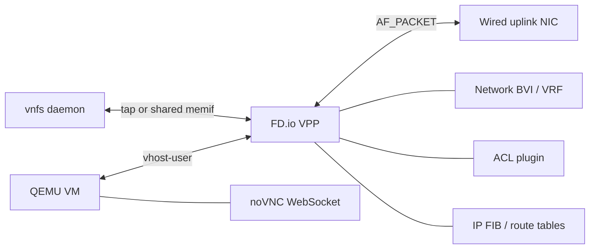

# Networking

Rookery Networks are VPP bridge domains. VMs attach through vhost-user
interfaces, VNFs run over taps or shared memifs, and optional NAT44 provides an
outside uplink. This document covers interfaces, ACLs, route tables, host
interfaces/taps, addressing, VNF runtimes, and NAT44.



The **Rookery Networks** tab creates a
bridge domain (the server allocates a free ID), then creates vhost-user interfaces
with generated MAC addresses. Attach an interface to a stopped VM; QEMU gets a
virtio-net device using that vhost socket on the next start. The VM creation form
can also select multiple unattached interfaces at once (`interface_ids`), and the
edit dialog can add or remove interfaces while the VM is stopped. On update,
omitting `interface_ids` leaves attachments unchanged; send
`replace_interface_ids: true` with an empty array to detach all interfaces. Only unattached or currently attached interfaces are offered,
and attachments change only when a VM starts.
Interfaces remain in VPP when a VM is deleted or the interface is detached, so
they can be reused.
VPP state is in memory. After a VPP restart, API startup reconciliation
recreates missing bridge domains, vhost-user interfaces, NAT44/BVI state, and
VNF taps. QEMU chardevs use `reconnect=1`, so VMs started with the current
arguments can reattach after VPP recreates the sockets; VMs started by an older
server without reconnect still need a stop/start. Vhost-user interfaces
require the VPP `vpp-plugin-core` plugin; if `vppctl show plugins` does not list
`vhost_plugin`, install the package and restart VPP. API-created networks are
isolated L2 bridge domains by default. NAT44 can be added as a VNF on a
dedicated network; the API then creates a BVI (`bvi<network-id>`) and takes
over the selected outside NIC. Do not point another NAT44 setup at the same
outside NIC.

## ACLs

The **Rookery Networks** tab also manages named ACLs. An ACL has a unique name,
title, description, and an ordered list of permit/deny rules. Each rule also
has its own optional description for documentation. Rules support IPv4/IPv6
source and destination CIDRs, `any`/`tcp`/`udp`/`icmp`/`icmpv6` protocols, and
TCP/UDP source/destination port ranges. The first matching rule
wins; unmatched traffic is denied.

ACLs are applied to Rookery Virtual Interfaces, not networks or VMs. Use **ACLs**
on an interface row to choose one or more **From interface** and **To interface**
ACLs by name. The dialog lets you order them: VPP evaluates the list in order,
so the first matching rule across the selected ACLs wins. "From interface"
filters traffic coming from that VM into VPP; "To interface" filters traffic
going from VPP to that VM. Rules are installed in VPP through the ACL plugin and
survive API/VPP reconciliation. The editor and assignment dialog both show the
full effective ACL text, including the implicit deny. An ACL cannot be deleted
while assigned to an interface.

## Route tables

Route tables are VPP IP FIB/VRF definitions. The **Route tables** subtab always
shows the default VRF (table `0`) for both IPv4 and IPv6, plus custom tables.
Custom tables have a name, a table ID, and an address family; the same ID may be
used once for IPv4 and once for IPv6. Create a table with **Add route table**,
then use **Route tables** on an interface row to bind its IPv4 and IPv6 FIBs.
Table `0` is always available and cannot be deleted. Deleting a custom table is
blocked while an interface or static route references it. VPP table definitions,
interface bindings, and static routes are recreated during startup reconciliation
after a VPP restart.

Use **Routes** on a table row to list, add, and delete static entries. Each route
has a prefix, an optional next hop, an optional egress, and a preference metric.
The egress can be a Rookery interface or any VPP interface by name, including a
network BVI; the UI offers both. When an egress is set and the next hop is
omitted, Rookery installs an attached/glean route, which is useful for importing
a bridge-domain subnet into a VRF without requiring ARP for a gateway. An
interface-only route is required when the gateway address belongs to the BVI
itself, because a `via <bvi-address> dev bviX` route can never resolve. When a
next hop is present, it must resolve inside the route's own table: bind the
owning interface into that table or add an interface-only route for the next
hop. The route editor works for the default VRF `0` as well as custom tables.

The route editor is a full page at
`/route-tables/{id}?ipv6=<bool>` (the legacy
`/route-tables/{id}/routes?ipv6=<bool>` form also works), so refreshing the
browser keeps the selected VRF open. The create page is `/route-tables/new`.
It also shows **Dynamic routes** read from the live VPP FIB:
connected/interface routes, DHCP and IPv6 ND routes, adjacency entries, and
other non-API sources. They are read-only and include source and forwarding
path details for troubleshooting.

The **Network** tab includes a **Troubleshoot** section. It currently renders
the active VPP packet-processing graph from `vppctl show vlib graphviz filter`;
node size is cycles/packet and color is packets/call. Interface-related nodes
(`*-input`, `*-output`, `*-tx`, BVI/VNF/host nodes) have a blue ring. The graph is
laid out top-to-bottom with input nodes at the top and terminal/drop nodes at the
bottom; feedback edges are dashed. Use the **Focus** picker to focus the
graph on one interface or packet feature (ACL plugin, NAT44, DHCP) and its
directly related nodes, or choose **All nodes**.
Drag to pan, scroll or use the `+`/`-` buttons to zoom, and use **Fit** to reset
the view. **Labels** shows all node names, while hovering a node isolates that
node and its directly connected neighbors. The graph is refreshed on demand, and
nodes are only shown if they were active since the last VPP stats clear. Interface
nodes appear only after the interface has processed traffic.

Each row in the **Network → Interfaces** tab shows its ACL assignments and compact
per-interface match totals. **ACL details** expands the row to show per-direction
and per-rule counters (`matched`, `denied`, and `permitted`) from VPP's applied
lookup contexts. These count explicit ACL rule matches since the ACL was applied;
implicit-deny packets are not included. If you only need a specific rule's count,
the rule row shows its own packet total and action.

The same **Troubleshoot** section includes **Packet trace**. Select a registered VPP node (or type a node name), set the packet count, and click
**Start trace**. Generate traffic through that node, then click **Show trace** to
read the VPP trace buffer. **Clear** removes the trace. The node picker is
populated from all registered VPP graph nodes; traces are capped at 1,000 packets.

The same **Troubleshoot** section includes **Packet capture**. Choose a VPP
interface (or `Any interface`), direction, maximum capture size, and snapshot
length. The API converts the size and snapshot length into VPP's packet-ring
limit, starts `pcap trace`, and stops it on demand. Captures are written by VPP
under `/tmp` as `rookery-*.pcap` and can be downloaded, opened in the embedded
WebShark viewer, or deleted. The active capture file cannot be deleted until the
capture is stopped. WebShark v3.0.0 is vendored under
`internal/webui/static/webshark` (GPL-2.0), with Roboto and Material Icons fonts
served locally; the upstream `ffmpeg-core.wasm` is omitted, so RTP audio playback
is unavailable while packet dissection works.

Network functions (**VNFs**) are attached to Rookery Networks. The **VNFs** tab
supports `dhcpv4`, `dhcpv6`, `nat44`, `bgp`, and `dns` functions; the VNF record
has a type, network, enable flag, and type-specific configuration. A network can
have one VNF of each type. Adding or editing a VNF opens a full page at `/vnfs/new`
or `/vnfs/{id}/edit`, so refreshing keeps the form open; lease and session
views remain dialogs.

DNS VNFs provide a small authoritative DNS server on the network's shared VNF
memif, reachable at the network service address (`.2`, UDP/TCP 53). Define
records with a name, type (`A`, `AAAA`, `CNAME`, `TXT`), value, and TTL; names
are fully qualified and may use a leading wildcard such as `*.lab1.test`.
Set **Forward names without a local record** to send other queries to the
configured upstream servers (IP or IP:port), or disable it to answer unknown
names with NXDOMAIN. If forwarding is enabled without upstreams, the daemon uses
`/etc/resolv.conf`. Local records always take precedence. Point DHCP clients at
the `.2` service address through the DHCP VNF's DNS field.

BGP VNFs are embedded GoBGP speakers with one peer, using the address family of
`local_ip` (IPv4 or IPv6 unicast). Choose a `memif` transport for a gVisor
userspace stack over VPP, or `tap` for kernel TCP. The configuration accepts
local/peer ASNs, router ID, local CIDR, peer address, optional peer gateway,
an optional advertised next hop (defaults to `local_ip`), multihop TTL
(default 64), passive mode, an optional TCP MD5 password (tap only), a raw
target VPP table ID, and advertised prefixes matching the session family. Received best paths are installed in the target VPP table and withdrawn
when the session or VNF stops; the BGP Status dialog shows the session state,
advertised prefixes, and received prefixes with next hop and AS path.

## Host interfaces

The **Host interfaces** section (under **Rookery Networks**) lists the Linux
NICs visible to the server. Physical, non-wireless interfaces that do not carry
the host default route can be **Attached to VPP**; this creates a
`host-<nic>` AF_PACKET interface in VPP (flushing host IP addresses on the
NIC). Attachments are persisted and recreated after a VPP restart. AF_PACKET
interfaces use 64 KiB RX frames so GRO/GSO bursts are not truncated, and
Rookery-created vhost/memif/BVI/tap interfaces use a 1500-byte MTU matching
the guest and typical physical networks. Rookery disables the Linux NIC's
GRO/LRO receive offloads (via `ethtool`) because NAT44 rewrites of coalesced
RX packets cause heavy TCP retransmissions, while keeping TSO/GSO enabled for
upload throughput. Upgrading from a version that used VPP's 2048-byte RX
frames recreates the host takeover once and reapplies NAT44. **Detach** removes
the VPP interface and returns the NIC to the host; the host may need to renew
DHCP. An interface used by a NAT44 VNF cannot be detached here.

## Host taps

**Host taps** (the next subtab under **Rookery Networks**) connect a Rookery
Network's bridge domain to a Linux tap interface on the server, so processes on
the host can reach VMs and other machines on that network without going through
a VM. Create one by choosing a network and an optional Linux interface name
(defaults to `hostnet<network id>`); the name is limited to 15 characters by
Linux. An optional IPv4 address inside the network CIDR (for example
`10.20.0.50/24`) is assigned to the host side of the tap; it must use the
network's prefix length and stay outside the first five reserved addresses, the
DHCP range, and DHCP static assignments. Leave the address empty to use DHCP or
configure the interface manually.

Host taps create a VPP tap (`hostnet…`) in the network bridge domain and bind it
to the network's VRF. They are stored in `network_host_taps` and recreated by
API startup reconciliation and after VPP restarts. Deleting a network also
deletes its host taps. The API is `GET`/`POST /api/host/taps` and
`DELETE /api/host/taps/{id}`; the create body accepts `network_id`, optional
`name`, and optional `ipv4_address`.

## Network addressing

Every Rookery Network requires an IPv4 CIDR and an IPv6 CIDR. The create dialog
defaults to `10.0.0.0/16` and `fd00:20::/64`. The first five host addresses of
each prefix are reserved for Rookery:

- `.1` — network BVI (gateway)
- `.2` — shared VNF memif stack
- `.3`–`.5` — reserved for future internal use

DHCP ranges, DHCP static assignments, and NAT44 DNAT local addresses must stay
inside the network prefix and outside the reserved addresses. The NAT44 gateway
must be the network BVI address (`.1`). The IPv6 CIDR currently defines the
allowed IPv6 range and reservations; IPv6 BVI/memif address assignment follows
with shared DHCPv6.

## VNF networking

DHCPv4 VNFs use one shared memif per network by default. Creating a network
creates the VPP memif master (`net<id>-vnf`, socket
`<memif-dir>/net-<id>.sock`) and stores its socket and interface index on the
network; the first shared VNF also creates the network BVI owning the gateway
(`.1`) and assigns the VNF address `.2` (the next host address) to the shared
gVisor stack. All DHCPv4 VNFs on that network use the same stack, so there is no
per-VNF memif or gateway tap. The stack binds UDP/67 on `.2` and reuses the
CoreDHCP allocator and lease plugin.

Each network also has its own VPP VRF table
(`100000 + network ID`, IPv4 and IPv6). The network BVI, shared VNF memif,
per-VNF taps/memifs, and vhost-user interfaces are all bound to that table, so
overlapping CIDRs across networks are valid and isolated. The table ID is
returned as `route_table_id`; use it as a BGP `target_table_id` to install
learned routes in the network's VRF.

The network VRF appears in the **Route tables** tab as `network-<name>` for
both IPv4 and IPv6, with table ID `100000 + network ID` and a
`network-managed` label. You can add static routes there; route table IDs from
`100000` upward are reserved for network VRFs and cannot be created manually.

The default is controlled by `networks.vnf_transport` (currently `shared`).
Each VNF can override it with `config.transport`:

- `shared` — network-wide memif and `.2` VNF address (DHCPv4 default)
- `dedicated` — per-VNF memif (`<memif-dir>/<vnf-id>.sock`, VPP interface named
  after the VNF), as in earlier releases
- `tap` — VNF tap interface

DHCPv6 currently remains on a tap, and BGP keeps its dedicated memif/tap
transport. Running VNFs keep their existing transport until restarted; a VPP
restart or VNF restart migrates DHCPv4 to the shared memif.

DHCP, DNS, and BGP runtimes live in a separate `vnfs` daemon, so restarting
the API does not interrupt them. Run it alongside the API:

```sh
sudo vnfs -vpp-socket /run/vpp/api.sock -listen unix:///run/rookery/vnfs.sock
```

`vnfs` owns the CoreDHCP servers, the DNS resolver, the gVisor memif stacks,
and GoBGP, writes
leases under `-run-dir`, restores its desired VNFs after its own restart, and
connects directly to the VPP binary API to install/withdraw BGP-learned routes.
The API keeps the database and all VPP provisioning (memif/tap creation, BVIs,
NAT44) and drives the daemon over an internal gRPC control channel
(`-vnf-addr`, default `unix:///run/rookery/vnfs.sock`; `tcp://host:port` is
supported). The API starts even when the daemon is absent — enabled VNFs show
`degraded` until it is reachable, and desired runtimes are re-ensured when the
daemon becomes reachable. The API queries runtime state on demand (VNF views
and start/stop/restart decisions) instead of polling; the daemon restores its
persisted desired specs on its own restart.

DHCPv4 uses CoreDHCP's DHCPv4 server with a per-VNF bitmap allocator. DHCPv6
uses CoreDHCP's DHCPv6 server with stateful IA_NA allocation from the configured
IPv6 range; it does not provide router advertisements or prefix delegation, so
clients must be configured to request DHCPv6. DHCPv4 VNFs can also define
`static_assignments`, a list of unique MAC/IPv4 pairs. The reserved address may
be inside or outside the dynamic range, but it must be a usable host in the
DHCP subnet and cannot be the gateway or service address. Reserved addresses
are kept out of the dynamic allocator, so a client MAC always receives its
assigned address. Static assignments are DHCPv4-only. Lease files live under
`<run-dir>/vnfs/<vnf-id>.json`, and the **Leases** action shows client ID,
address, hostname, expiry, and active state. The server does not use CoreDHCP's
`range` plugin because that plugin imports the CGO `mattn/go-sqlite3` driver;
leases are stored as JSON instead, keeping the project CGO-free.

NAT44 is IPv4-only. Use a dedicated network whose only purpose is NAT. On
enable, the NAT44 VNF:

- creates or reuses the network BVI (`bvi<network-id>`), adds the configured
  gateway (for example `10.20.0.1/24`), and stores it on the network record;
- refuses any host default-route NIC and wireless NICs, flushes the selected
  wired outside NIC's host addresses, and creates a VPP `host-<nic>` interface
  with the physical NIC's MAC address (required for upstream ARP/switch compatibility);
- enables VPP NAT44-ED and marks the BVI inside and the outside interface out;
- uses a static outside address and default route when `outside_address` is set,
  or starts the VPP DHCP client (which installs the leased address and default
  route) when it is empty; `outside_gateway` is required for a static default
  route;
- optionally adds a NAT44 pool with `nat44_pool` (address or `start-end`);
- optionally forwards TCP/UDP ports from the outside address to services on the
  NAT network with `dnat_rules` (DNAT / port forwarding).

A DNAT rule has a `protocol` (`tcp` or `udp`), an `external_port`, and the
internal destination's `local_ip` and `local_port`. The external address is the
outside interface's current address, so rules also work when the address comes
from DHCP. The internal address must be a usable host in the NAT44 subnet.
Rules are stored with the VNF and are restored after VPP restarts. For example:

```json
"config": {
  "gateway": "10.20.0.1/24",
  "outside_interface": "enp9s0",
  "dnat_rules": [
    {"protocol": "tcp", "external_port": 8080, "local_ip": "10.20.0.100", "local_port": 80},
    {"protocol": "udp", "external_port": 5353, "local_ip": "10.20.0.101", "local_port": 53}
  ]
}
```

Saving the NAT44 VNF restarts its NAT44 configuration, so existing
translations may be interrupted briefly.

If a DHCPv4 VNF exists on a NAT network, the BVI keeps `.1` and the DHCP server
uses the next address (`.2`) as its bind/service address (shared stack or tap,
depending on transport). Clients still receive the BVI gateway (`.1`) as their
router. Creating a DHCPv4 VNF later on a network with a BVI applies the same
rule. The DHCP range must be inside the NAT subnet and must not include the
service address. NAT44 does not create a tap or leases; use the **Sessions**
action or `GET /api/vnfs/{id}/sessions` to inspect VPP translations. Disabling/deleting
NAT44 removes its NAT44 interface configuration, pool, and DNAT static-mapping
rules. The BVI is removed once no NAT44 or NAT-adjusted DHCPv4 VNF depends on
it. The VPP `host-<nic>` takeover and outside addressing remain; detach the host
interface manually to return the NIC, because host addresses flushed during
takeover are not restored automatically.

A VNF is `running` when its server is active (or NAT44 is applied), `disabled`
when the enable flag is off, and `degraded` when it is enabled but the runtime
is missing. When the API service starts, it waits for VPP, ensures every
recorded Rookery Network bridge domain exists (recreating a missing domain with
its DB-assigned ID), reconciles recorded vhost-user interfaces by name,
restores ACL definitions and interface assignments, reconciles enabled NAT44 VNFs (BVI, outside interface, and NAT rules), and then
reconciles enabled DHCP, DNS, and BGP VNFs through the `vnfs` daemon. Shared
DHCPv4 stacks are re-ensured on the network memif; per-VNF taps/memifs are
recreated when missing, and a VPP restart also recreates the network memif/BVI
state. This happens before any manual **Restart** is needed.

While the API is running, it control-pings the VPP binary API every five
seconds and compares the API socket identity. If VPP restarted, the API clears
its cached NAT/VNF runtime state and rebuilds bridge domains, vhost-user
interfaces, ACLs, NAT/BVI state, and VNF taps/memifs automatically. VMs started with
`reconnect=1` can reattach after the vhost socket is recreated; older VMs may
still need a restart. The rebuild runs in a background worker so health checks
continue, and a further VPP restart queues another rebuild after the in-flight
one finishes.

A VPP restart also removes vhost-user interfaces and the VM connections that
used them. On API startup, recorded vhost-user interfaces are looked up by name
and recreated if missing, with their stored MAC and socket path; the database
`sw_if_index` is updated. QEMU's chardev `reconnect=1` lets current VMs reattach
after the socket is recreated; older VMs may still need a stop/start. Deleting
a VNF stops its runtime, removes its tap/memif resources, and deletes its
leases. Existing network-level DHCP configuration is migrated into a DHCPv4
VNF; the first startup reconciliation/restart of that VNF removes the old
`ndn<network-id>` tap.
